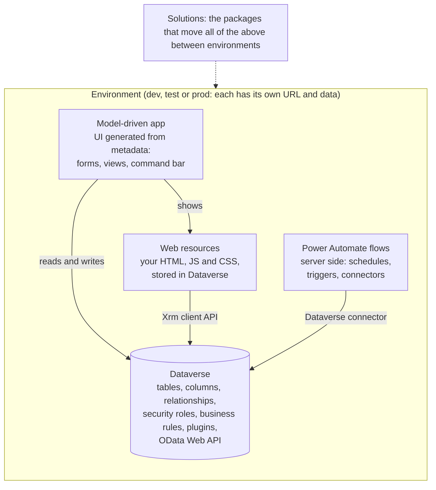
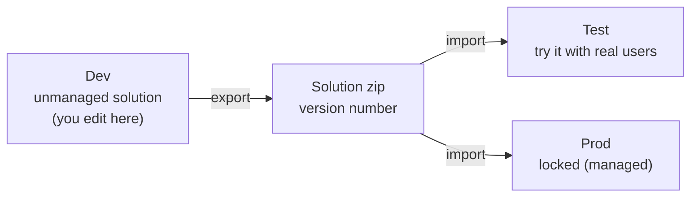

# Power Platform for web developers

> **For:** anyone who knows web development but not Power Platform. **Read:** once, first.

You know HTML, JavaScript, REST APIs and databases. Power Platform uses all of them, under
different names and with a few strong opinions. This page maps what you know to what you will
meet. It explains the platform only; how this repository uses it is the next page.

## The big picture



*Where each piece lives. Everything in the box belongs to one environment.*

Environments are separate copies. Work moves from one to the next as a **solution**:



*The path of a change. Nothing is edited by hand in test or prod.*

| You know | Power Platform calls it | Notes |
|---|---|---|
| A database + its REST API | **Dataverse** | Hosted SQL underneath, but you only ever touch it through the Web API, the UI or connectors. |
| Table, column, row | **Table, column, row** (old docs: entity, attribute, record) | Old names still appear in APIs: `EntityDefinitions`, `getEntityName()`. |
| Enum | **Choice** (old: option set, picklist) | Stored as an integer (`2`), shown as a label (`High`). Labels can change; values should not. |
| Boolean | **Yes/No** | Also has labels. |
| Foreign key | **Lookup** | Read as `_<column>_value`, written as `<NavigationProperty>@odata.bind`. |
| Join table | **N:N relationship** | Dataverse creates a hidden intersect table; you link with Associate. |
| Soft delete / "archived" | **Status** (`statecode` 0 Active / 1 Inactive) + **Status reason** (`statuscode`) | Most lists show only active rows. Prefer deactivating to deleting. |
| Admin CRUD screens | **Model-driven app** | Forms, views and navigation generated from table metadata. You configure, not code. |
| Static files on a CDN | **Web resources** | HTML, JS, CSS, images stored as rows in Dataverse and served from the org URL. |
| The browser SDK | **Xrm client API** | `Xrm.WebApi`, `Xrm.Navigation`, `formContext`... available inside the app. |
| Cron jobs, webhooks, integration glue | **Power Automate cloud flows** | Built in a designer (or here, as code). Same engine as Azure Logic Apps. |
| OAuth clients/credentials for an integration | **Connections** and **connection references** | A connection is a signed-in account for a connector; a reference is a named slot a flow uses, filled per environment. |
| Git release / deploy artifact | **Solution** | A zip of customizations. Unmanaged in dev (editable), managed in prod (locked). |
| npm scope / namespace | **Publisher** and its **prefix** | Every custom name starts with the prefix (`pidev_`). Pick the publisher once per project. |
| Staging/production servers | **Environments** | Separate orgs with their own URL and data: `<org>.crm3.dynamics.com`. |
| Roles and permissions | **Security roles**, **business units**, **teams** | Row-level: a role says create/read/write/delete at user, business unit or organization depth. |
| DB triggers / server middleware | **Plugins** (C#), **business rules**, **classic workflows** | Run inside Dataverse on create/update. Not covered by this project, but they may exist and change your data. |

## Names: the thing that trips everyone

A single column has up to four names. Using the wrong one is the most common bug.

| Name | Example | Used in |
|---|---|---|
| Display name | `Position` | The UI. Translatable, changes freely. Never use in code. |
| Logical name | `pidev_manager` | FetchXML, `$select`, `$filter`, `Xrm.WebApi` table argument, form `getAttribute`. All lowercase. |
| Schema name | `pidev_Manager` | Navigation properties for writing lookups: `pidev_Manager@odata.bind`. Case-sensitive. |
| Lookup read property | `_pidev_manager_value` | Reading a lookup's id from the Web API. |

Tables have the same split, plus the **entity set name** used in Web API URLs and
`@odata.bind` paths and in Power Automate's Dataverse actions: `account` → `accounts`,
`pidev_address` → `pidev_addresses` (custom tables usually get the logical name plus "s" or
"es", which gives odd plurals).

The rules this repository follows for these names are in
[conventions](../8-reference/conventions.md#dataverse-names).

## Where your code runs

```
Form page (Xrm global)
 ├── command.js ← loaded when the user clicks your command button
 │      └── Xrm.Navigation.navigateTo(...) opens:
 └── <iframe> page.html + page.js  (Xrm lives on window.parent)
```

- There is **no server code** in this project. Everything runs in the user's browser, with
  **the user's permissions**. If they cannot read a table, your page cannot either. Test with a
  normal user's role, not only as an admin.
- Web resources are **not a free-standing website**. They only work inside the app, where the
  user is signed in and Xrm exists. That is why the preview fakes Xrm.
- There is no build step on the server. The built files are uploaded and **published** (the
  Web Resources Manager in XrmToolBox does both).
- Customizations are cached. After publishing, hard-refresh (Ctrl+F5) or the old script runs.

## Talking to Dataverse

| Way | Use for |
|---|---|
| `Xrm.WebApi` (in the browser) | CRUD from web resources |
| Web API over HTTP (`/api/data/v9.2/`) | metadata, anything Xrm.WebApi lacks |
| FetchXML | rich queries (joins, aggregates); also what views are made of |
| Dataverse connector | flows |

OData in one minute:
```
GET accounts?$select=name,_ownerid_value&$filter=statecode eq 0 and contains(name,'air')&$orderby=name&$top=10
```
Strings in filters use single quotes, doubled when they contain one.
Ask for formatted values (choice labels, lookup names) with the header
`Prefer: odata.include-annotations="*"`; they come back as
`<property>@OData.Community.Display.V1.FormattedValue`.

## Solutions and environments

- **Dev** is where you change things, inside your **unmanaged** solution. Always add components
  to the solution (Solutions → your solution → Add existing / New). Things created outside a
  solution land in the "Default solution" and are easily lost at deployment.
- **Test/Prod** receive the solution by export and import (often **managed**: locked, removable
  as a whole). Do not edit prod by hand; the next import overwrites or conflicts with it.
- A solution carries tables, columns, forms, views, apps, web resources, flows, connection
  references, security roles. It does **not** carry data rows or connections (credentials).

## Flows in one minute

A flow is a trigger (schedule, row changed, button, HTTP) plus a list of actions. Each action
has `runAfter`: which earlier action it waits for and with which outcome (Succeeded, Failed...).
Expressions start with `@` (`@outputs('Find_user')?['body/value']`) and look like a small
functional language (`concat`, `formatDateTime`, `if`, `equals`). Runs are listed in the flow's
run history, where each action's inputs and outputs can be opened: that is your debugger.

## Licensing and limits you will meet

- Dataverse connector actions in flows are **premium**: the flow owner needs a license that
  includes them.
- Web API calls are throttled per user (service protection limits). Avoid request loops; fetch
  in one query with `$filter` instead of one request per row.
- Flow loops can run items in parallel. Run them one at a time when order matters or when the
  loop writes to a variable.

## Further reading

Microsoft's docs are good once you know what to search for:
[Dataverse developer guide](https://learn.microsoft.com/power-apps/developer/data-platform/),
[Client API reference](https://learn.microsoft.com/power-apps/developer/model-driven-apps/clientapi/reference),
[Web API](https://learn.microsoft.com/power-apps/developer/data-platform/webapi/overview),
[Power Automate expressions](https://learn.microsoft.com/azure/logic-apps/workflow-definition-language-functions-reference).
Unfamiliar words: [glossary](../8-reference/glossary.md).

**Next:** [How the project works](02-how-the-project-works.md)
