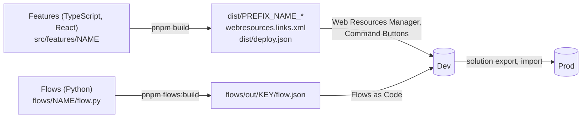
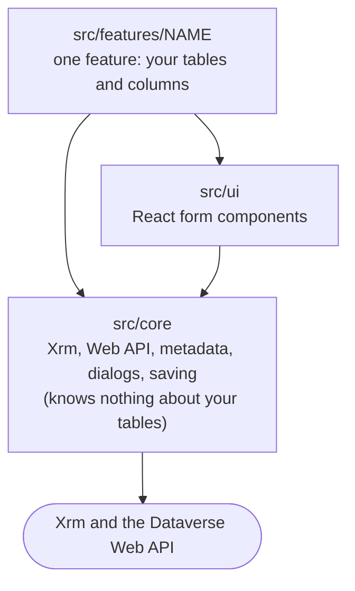
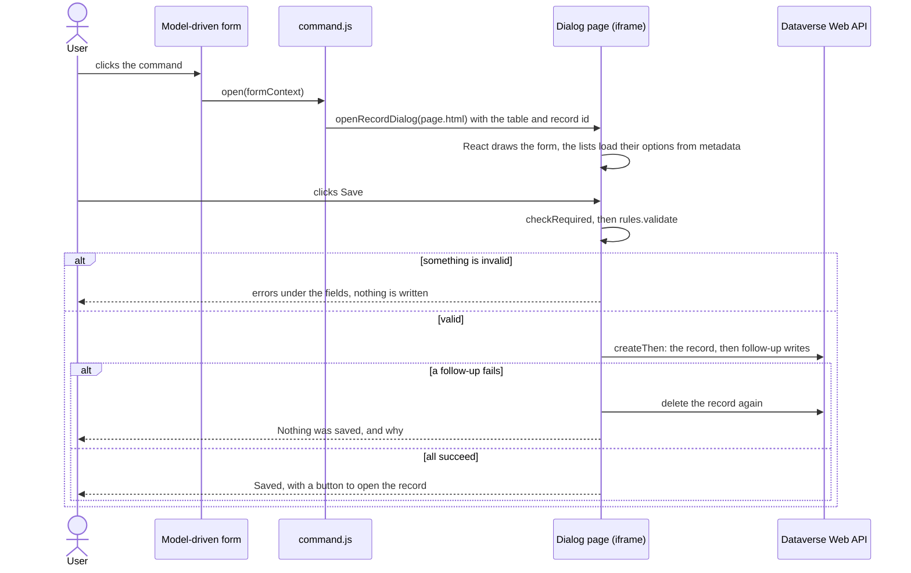

# How the project works

> **For:** everyone working in this repository. **Read:** once, after the platform page.
> **Result:** you know what the parts are, why they are split this way, and what each tool is for.

Step-by-step tasks are in the guides ([build a feature](../4-build/build-a-feature.md)); exact
formats and options are in the [reference](../8-reference/project/commands.md).

## What a project produces

*Two outputs, each pushed to dev by an XrmToolBox tool, then moved to prod in a solution.*

**Features** are a command bar button and, usually, a dialog page; **flows** are Power Automate
cloud flows. Everything else exists to write those two outputs quickly and safely: a shared
core, a scaffold, a local preview, tests, and read-only checks against a real environment.

## Three layers of code

*Code only calls downward. A feature never touches Xrm or fetch directly.*

The rule: **a feature never calls `Xrm` or `fetch` directly, and the core never names a project
table.** The core does not import React either, so it is the same in every project and is tested
without a screen. Every feature reuses the same tested code for lookups, choice options, dialogs,
rollback and environment detection. When two features need the same helper or piece of UI, it
moves down into the core or the UI kit.

## A feature

`pnpm new:feature` creates one folder per feature, one subfolder per concern:

| Path | Job |
|---|---|
| `config.ts` | every Dataverse name the feature uses; the only place they are written |
| `schema.ts` | what the feature expects to find in Dataverse, built from `config.ts` |
| `command/index.ts` | the command button's entry point |
| `page/` | the dialog: `index.tsx` (mounts React), `<Name>Page.tsx` (layout and state), `fields.ts` (the fields as data), `page.html`, `page.css` |
| `logic/` | validation and business rules as pure functions (no React, no DOM, no Xrm) |

Details: [feature files](../8-reference/web-resources/feature-files.md). What React can and cannot do here:
[React in a web resource](03-react-in-web-resources.md).

## What happens at run time

*One click, end to end. The page runs as the signed-in user, with that user's security roles.*

The page runs in an iframe, so `getXrm()` finds Xrm on the page or its parent. Saving can be
several writes, so `createThen` deletes the record again when a follow-up write fails: a
half-saved record is never left behind.

## Working without Dataverse: the mock

Web resources only run inside the app, so the project fakes the app. `tools/preview/mock-xrm.js`
implements the parts of Xrm the core uses on a JSON file and records every write instead of
saving it. One fake serves the preview (`pnpm dv:preview`, on `tools/preview/mock-data.json`,
edit freely), the unit tests and the browser tests (both on `test/fixtures/mock-data.json`,
fixed). A page that works in the preview behaves the same in the tests. The mock does not simulate
security roles, plugins, business rules or full query semantics:
[mock Dataverse](../8-reference/web-resources/mock-dataverse.md).

## Names, and flows as code

The build writes `dist/<prefix>_<feature>_<file>`, and each file is uploaded under exactly that
name, for example `pidev_quick_task_page.html`. A web resource is a flat file (no folders in
Dataverse): the source `page.html` uses plain `page.js`/`page.css` references and the build
rewrites them to the files' full names, while the preview serves them under the plain names, so
one source works both places. The prefix comes from `webresources.config.mjs` and is injected at
build time; no file hard-codes it.

Flows are Python files (`flows/<name>/flow.py`) written with a small library, `flowkit`. The build
checks them for mistakes the designer would only show at run time (wrong expression function
names, unbalanced brackets, `items()` outside its loop...) and writes plain flow JSON. See
[build a flow](../5-flows/build-a-flow.md).

## The shared kit

Every project made from the starter shares most of its files with it: `src/core`, `src/ui`,
`flows/lib/flowkit/`, `tools/`, the tests of those, the configs (`setup.cmd`, lint, test and
TypeScript settings, CI workflows) and the shared docs. That set is the **kit**, and `kit.json`
lists it. Your features, flows, mock data and settings are yours, not the kit's.

The kit files live in your project like any other file, so you can read and change them.
`kit.json` records the version of each one. `pnpm kit:status` lists the kit files you changed;
`pnpm kit:update <starter folder>` brings in a newer starter (your changes are kept, the new version
goes next to them as `<file>.kit-new` to merge), and `pnpm kit:push --pr` sends a kit fix of yours
to the starter as a pull request. Fixes reach every project without copying files by hand:
[update the kit](../7-maintain/update-the-kit.md), [send kit changes back](../7-maintain/send-kit-changes-back.md).

## The tools, and why each exists

**Build outputs.** The build hands the XrmToolBox tools everything they need, so nothing is typed
twice:

| File | Written by | Read by |
|---|---|---|
| `dist/<prefix>_<feature>_*` | `pnpm build` | Web Resources Manager (the files it uploads) |
| `webresources.links.xml` | `pnpm build` | Web Resources Manager: which file is which web resource |
| `dist/deploy.json` | `pnpm build` | Command Buttons (the buttons to create), `pnpm dv:verify` |
| `flows/out/<key>/flow.json`, `flows/out/flows.json` | `pnpm flows:build` | Flows as Code (the flows to push), `pnpm dv:verify` |

**XrmToolBox tools** push to dev and test only, and refuse production
([XrmToolBox tools](../8-reference/tools/overview.md)):

| Tool | Exists because |
|---|---|
| Web Resources Manager | uploading and publishing web resources by hand is slow and error-prone; it pushes only what changed |
| Command Buttons | a command bar button needs a library, a function and parameters set exactly; it creates them from `dist/deploy.json` |
| Flows as Code | the flow's code stays the source: it pushes `flow.json` into the existing flow (off, update, on), or creates a new flow from its file (off); its **Runs** tab shows each run and its error |

**`pnpm dv:*` commands** read Dataverse through pac, signed in as you. They never write:

| Command | Answers |
|---|---|
| `pnpm dv:q` | any FetchXML query: what is really in the table? |
| `pnpm dv:pull` | a table's real names and choices, as a `config.ts` snippet and mock data |
| `pnpm dv:access` | can this user work here: roles, publisher, solution? |
| `pnpm dv:verify` | is everything the last build produced in the environment, and are the flows on? |
| `pnpm test:dataverse` | does Dataverse still have every table and column each `schema.ts` lists? |

The offline tests prove the code agrees with the mock; these prove the mock agrees with Dataverse.
Every command and option: [commands](../8-reference/project/commands.md).

## Access

Every tool that reaches Dataverse goes through the Power Platform CLI (pac), signed in with your
own account. The repository never sees a password or token. See
[access and security](../9-help/access-and-security.md).

**Next:** [React in a web resource](03-react-in-web-resources.md) · [Install and sign in](../2-set-up/01-install.md)
