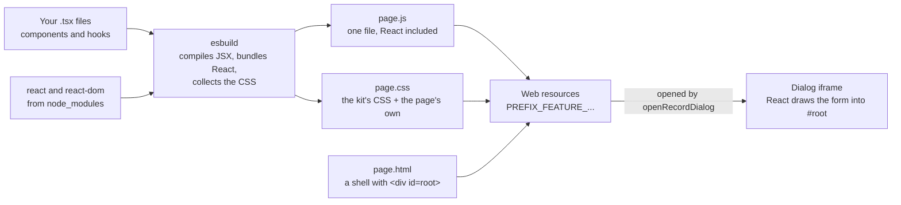

# React in a web resource

> **For:** anyone new to React in Power Apps. **Read:**
> after [How the project works](02-how-the-project-works.md). **Short answer:** a web resource is a
> static file served by Dataverse, so a React page is possible; this page says what that costs and
> what it does not allow.

## Why it works

Dataverse does not care what is inside a JavaScript web resource. It stores `page.html`,
`page.js` and `page.css`, and serves them to an iframe. React, bundled into `page.js`, is just a
bigger `page.js`. Nothing on the server is involved: no Node, no server rendering, no router.



*How a React page becomes web resources. The output has the same four files as any other feature.*

## What the platform limits

| Limit | What it means here |
|---|---|
| A web resource is **one flat file** with a name like `pidev_quick_task_page.js` | There is no code splitting or lazy loading: React and the page are one bundle. |
| A web resource file is **at most 5 MB** by default | The page is about 0.7 MB unminified (75 KB gzipped when minified). Plenty of room, but it grows with every library you add. |
| The page runs **in an iframe**, and **Xrm lives in the parent window** | The core's `getXrm()` finds it, so React code never touches `window.Xrm` directly. |
| No server | No server components, no server-side rendering, no framework that needs a Node server (Next.js, Remix). A bundler plus a client-side library is what fits. |
| **No eval** at run time | React's production build does not use it. Do not add libraries that compile templates in the browser. |
| Only **some file types** can be uploaded (HTML, JS, CSS, images, SVG, XML...) | Source maps cannot be published, so stack traces in production point into the bundle. `pnpm build` keeps the bundle readable; `pnpm build --minify` makes it smaller and the stack traces unreadable. |

## How a page works in React

A page describes what the form looks like for the current state, and React updates the elements.

| Question | Answer |
|---|---|
| Where is the answer to "what did the user pick?" | in the page's **state** |
| How does a conditional field appear? | `{show && <Field ... />}`, recomputed on every render |
| How is a stale lookup result ignored? | the effect's **cleanup** marks the result stale |
| How is a field tested? | by **role and name**, as a user would (`getByRole("combobox", { name })`) |
| What if you forget to update something? | nothing: the screen is computed from state |

The elements keep their ids (`#subject`, `#status`, `#save`), which the browser tests and the preview use to find
controls.

## What stays outside React

The code that does not draw anything is plain TypeScript, with no React import:

| Folder | Why it does not use React |
|---|---|
| `src/core/` | Xrm, Web API, metadata, saving with rollback, navigation. A test fails if it imports React. |
| `src/features/<name>/logic/` | Rules and payloads. Pure functions are the easiest code to test and to move. |
| `src/features/<name>/page/load.ts`, `formState.ts`, `testData.ts` | Loading and state changes as functions of plain data; the components only call them. A small feature has none of these; a larger one adds them. |

## What was not chosen, and why

| Option | Why not |
|---|---|
| **PCF** (Power Apps component framework) | The right tool for a custom control that replaces a field or grid *inside* a form. This project opens a dialog from a command button, which a web resource does with far less packaging. |
| **Vue, Svelte, Solid** | They bundle the same way. React was chosen for its ecosystem and testing tools; the structure here (state, specs, hooks) carries over. |
| **A state library** (Redux, Zustand) | One dialog has one form. `useReducer` is enough, and a reducer is a plain function that is tested without React. |
| **A UI library** (Fluent UI, MUI) | They add hundreds of KB and their own styling. The small kit in `src/ui/` matches the model-driven app with a few CSS variables. |
| **Vite** | esbuild already bundles the web resources in one step; Vite's dev server does not know the `PREFIX_feature_` names or the mock Xrm. |

## Rules of hooks, in practice

React has two rules the linter (`eslint-plugin-react-hooks`) enforces, so the build fails if they
are broken:

1. **Call hooks at the top of a component or hook**, never inside an `if`, loop or callback.
2. **List everything an effect uses** in its dependency array, so it runs again when that changes.

The example dialog has a single effect, the one that reads Dataverse when the page opens. Any
effect that waits for an answer follows the same pattern, which you can copy:

```tsx
useEffect(() => {
  let current = true;
  const stale = () => !current;       // a function, so it is read again after each await
  void (async () => {
    const result = await somethingSlow();
    if (stale()) return;              // the page changed in the meantime: ignore this answer
    setState(result);
  })();
  return () => { current = false };   // cleanup: runs before the next effect and on unmount
}, [dependencies]);
```

**Next:** [Install and sign in](../2-set-up/01-install.md) · [Build a feature](../4-build/build-a-feature.md) · [UI components](../8-reference/web-resources/ui-components.md)
