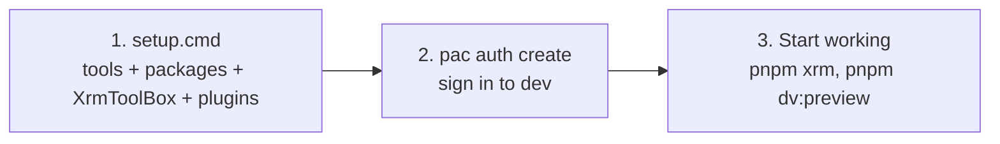

# Install and sign in

> **For:** anyone setting up a Windows work laptop. **Result:** the tools installed, the
> project's packages installed and tested, XrmToolBox with the team's tools, and pac signed in to
> dev. Once per laptop; the sign-in once per environment. No administrator rights are needed.



*The four steps below. When something fails, run the doctor before changing anything.*

## 1. Run setup.cmd

Double-click `setup.cmd` in the project folder, or run it from a terminal opened there:

```powershell
.\setup.cmd
```

It installs only what is missing, for your user: Scoop, PowerShell 7, Git, Node 24, pnpm, uv and Python. Then it
installs the project's packages (`pnpm install`, `uv sync`), Ollama and the model of the docs'
[AI chat](03-ask-the-docs.md) (about 2 GB, once), and runs the offline tests. It is safe
to run again: what is there and works is left alone. Last, it checks that Node and pnpm also work
in a new terminal, not only in this window.

| Option | Does |
|---|---|
| `-SkipBrowser` | skips the Chromium download; the browser tests then use Microsoft Edge |
| `-SkipDocsChat` | skips Ollama and the docs' AI chat model |
| `-Doctor` | checks everything and changes nothing (below) |
| `-Clean` | clears a mixed-up Node and pnpm without asking (below) |

Options go after the name: `.\setup.cmd -SkipBrowser`.

Before installing, it looks for the usual causes of trouble: an administrator window, a project
folder inside OneDrive or with `(` `)` in its path, little disk space, no route to the download
sites. A failed step is marked **FAIL** with **What to do** under it. A step that needs a failed one
is skipped, and running `setup.cmd` again continues where it stopped. Everything is written to
`setup.log` in the project folder: send that file when you ask for help.

**Why `setup.cmd` and not `setup.ps1`?** Windows refuses to run a PowerShell script that came from
a download or a zip ("is not digitally signed"). `setup.cmd` starts `setup.ps1` with that check
switched off for that one window only, and changes no setting. If your laptop's policy blocks
`setup.cmd` too, run `Unblock-File .\setup.ps1` and try again, or ask IT.

**Node 24, and only one.** The project uses Node 24 (`.nvmrc`, `package.json`). When setup finds
another Node, a `pnpm` that does not run, or nvm blocking tools ("NVM blocked package-manager
execution", NVM4306), it lists the problems and asks before clearing them. If you agree (or ran
`.\setup.cmd -Clean`), it uninstalls nvm and scoop's Node and pnpm, removes nvm from your user
`PATH`, then installs Node 24 with scoop and pnpm through corepack. Other projects that used nvm
then use this Node 24 too. Say no if nvm is managed for you, and ask your administrator.

### Something is wrong? Run the doctor

```powershell
.\setup.cmd -Doctor
```

It installs and changes nothing. It checks the execution policy, the usual blockers, each tool
and its version (Node must be 24, pnpm must run, also in a new terminal), the project's packages (`node_modules`, `.venv`), the
pac sign-in and any proxy settings. It writes `doctor-report.txt` in the project folder: send that
file to whoever helps you.

To install or repair one tool yourself, follow [install by hand](01-install/01-by-hand.md). It
starts with a check of what is already on the laptop, which avoids most install problems.

## 2. Install XrmToolBox and the team's tools

`setup.cmd` already downloaded XrmToolBox and installed the team's plugins for you.

[XrmToolBox](https://www.xrmtoolbox.com) is a Windows app that hosts tools for Dataverse. You push
your work to dev with three of them:

| Tool | Pushes |
|---|---|
| Web Resources Manager | the built web resources, through `webresources.links.xml` |
| Command Buttons | the command bar buttons described in `dist/deploy.json` |
| Flows as Code | the flows in `flows/out/<key>/flow.json`; its **Runs** tab shows runs and errors |

To start XrmToolBox with the latest plugin updates:

```powershell
pnpm xrm                              # checks updates and launches XrmToolBox
# or: tools\xrmtoolbox\launch.cmd
```

It checks the latest releases of the team's tools, downloads any updates into
`%AppData%\MscrmTools\XrmToolBox\Plugins`, and starts XrmToolBox.

`setup.cmd` also places an **XrmToolBox** shortcut on your Desktop. Right-click the shortcut and
choose **Pin to taskbar** (or **Pin to Start**) for 1-click access anytime: every launch automatically
checks for and applies the latest plugin updates before starting.

In XrmToolBox, the tools are in the **Tools** list. Connect to **dev** with your own work account.

Installing by hand, a portable XrmToolBox, pointing each tool at the project, or a tool that does
not show: [Set up the XrmToolBox tools](01-install/02-xrmtoolbox-tools.md).

The tools push to dev and test only: each asks once per environment which one it is, and
production is refused.

## 3. Sign in to Dataverse with pac

pac (the Power Platform CLI) is how every `pnpm dv:*` command and `pnpm test:dataverse` read
Dataverse. Sign in to dev:

```powershell
pac auth create --environment https://<org>.crm3.dynamics.com
```

A browser window opens; sign in with your work account. Then:

```powershell
pac org who        # who you are and which environment is active
```

pac keeps one sign-in profile per environment; switching and removing profiles is in
[commands](../8-reference/commands.md). pac is the only sign-in the tools use. Other methods are
blocked by the organization on purpose: read [access and security](../9-help/access-and-security.md)
before trying anything else, and never work around a sign-in or Conditional Access block.

`pac` not found? `setup.cmd` installs it automatically; with the VS Code extension, you can also use VS Code's
terminal. Both ways are in [install by hand](01-install/01-by-hand.md#5-power-platform-cli-pac).

## 4. Check it works

From the project folder:

```powershell
pnpm dv:q tools/queries/my-user.xml     # prints your own user record from Dataverse
pnpm check:all                           # every check and test passes
```

When both pass, your laptop is ready. If one fails, run `.\setup.cmd -Doctor`, then see
[troubleshooting](../9-help/troubleshooting.md).

**Next:** [your first feature](../3-first-feature/first-feature.md), which shows you are ready for a
real task. Creating a project? [Start a new project](02-start-a-new-project.md).
