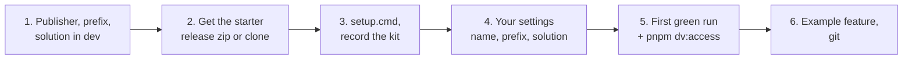

# Start a new project

> **For:** whoever creates a new project from the starter. **Needs:** a laptop set up as in
> [install](01-install.md), and access to the dev environment. **Result:** a project of your
> own, linked to the starter's kit, green on every check, with your access in dev confirmed.
> Once per project.



*The six steps below.*

## 1. Choose the publisher and create the solution in dev

Every component you add to Dataverse belongs to a **publisher**, whose **prefix** starts every
custom name (`pidev_...`). Use your team's existing publisher when there is one:

```powershell
pnpm dv:q tools/queries/publishers.xml
```

(Run it from any project made from the starter, or after step 3.) Note the publisher's
`uniquename` (no spaces), `customizationprefix` and `customizationoptionvalueprefix`. If there is
none, create one with the solution below (**New publisher**: display name, name, a prefix of 2 to
8 lowercase characters, a choice value prefix).

Then create the project's solution in **dev**:

1. [https://make.powerapps.com](https://make.powerapps.com) → pick the dev environment (top right) → **Solutions** →
   **New solution**.
2. A display name and a name (for example `SiteVisits`), the publisher above, version `1.0.0.0`.
3. Create it. Every table, column, web resource and flow of the project goes in this solution.

## 2. Get the starter

You need two folders side by side: **the starter**, kept untouched (later kit updates come from
it), and **your project**, a copy of it.

| From | Do |
|---|---|
| the starter's release zip (from its GitHub Releases page; ask your mentor for the link) | unzip it to `..\pp-starter-react`, then copy that folder to `..\my-project` |
| a clone of the starter's repository | `git clone <starter repository> pp-starter-react`, then copy it without its git history: `robocopy pp-starter-react my-project /E /XD .git` |

The release zip has been through every check (`pnpm release`), so prefer it. Keep the project out
of OneDrive and out of paths with `(` `)`.

## 3. Install and record the kit

In the project folder, before changing any file:

```powershell
.\setup.cmd                              # packages and offline tests, as in install
pnpm kit:update ..\pp-starter-react      # records which kit version your project starts from
pnpm kit:status                          # "Kit <version> from pp-starter-react. 0 kit file(s) differ from it"
```

The **kit** is the part every project shares with the starter: `src/core`, `src/ui`, flowkit,
`tools/`, the tests of those, the configs and the shared docs. `kit.json` lists it. Your project
keeps its own copy of these files, and `kit.json` records the version of each one, so a later
`pnpm kit:update` brings in the starter's fixes without losing your changes. That is why this
first update runs before any edit: it only records, and changes nothing. Later updates:
[update the kit](../7-maintain/update-the-kit.md). What the kit is for:
[how the project works](../1-learn/02-how-the-project-works.md#the-shared-kit).

The other way round, a kit file you fix in your project can go back to the starter as a pull request
(`pnpm kit:push --pr`, optionally from a `pre-push` hook). Set it up, and list the files that are only
yours under `exclude`, with [send kit changes back](../7-maintain/send-kit-changes-back.md).

## 4. Your settings

| File | Set |
|---|---|
| `package.json` | `name` and `description` |
| `webresources.config.mjs` | `prefix`: the publisher's prefix |
| `flows/solution.json` | `uniqueName` and `displayName` (the solution from step 1), `publisher` (the publisher's **unique name**), `publisherDisplayName`, `prefix`, `optionPrefix` |

Every setting is described in [configuration](../8-reference/configuration.md).

## 5. First green run, and your access

Sign in to dev if you have not ([install, step 3](01-install.md#3-sign-in-to-dataverse-with-pac)), then:

```powershell
pnpm check              # format, lint, types, tests, flow checks, docs build
pnpm test:dataverse     # the example feature's tables exist in dev
pnpm build              # dist/, webresources.links.xml, dist/deploy.json
pnpm dv:access          # your user, roles, the publisher and the solution
```

`pnpm dv:access` reads dev through pac and prints one line per check: `ok`, `NO`, or `?` when it could not read (the line says why). It also lists your teams.

| Check | Fix when it says NO |
|---|---|
| your user exists and is enabled | ask the environment's admin to add you |
| you have **System Customizer** (directly or through a team) | ask the admin for the role; other roles: `--roles "System Customizer,Basic User"` |
| the publisher with your `prefix` exists | check `prefix` in `webresources.config.mjs` (step 4) |
| the solution named in `flows/solution.json` exists | check `uniqueName` (step 4), or create the solution (step 1) |

All of it passes before you write any code; if not, see
[troubleshooting](../9-help/troubleshooting.md). Checking someone else's access:
[deploy, before you start](../6-ship/deploy.md#before-you-start).

## 6. The example feature, and git

`quick-task` is a working feature: a command that opens a React dialog creating a task regarding
the current record. Its page also has a "Component showcase" under the form, which shows every
UI kit component with sample data. Read it once (its `config.ts`, then `QuickTaskPage.tsx`), then
keep it as a reference or remove it:

- delete `src/features/quick-task/`, `test/unit/quick-task.test.tsx`, `test/e2e/quick-task.spec.ts`;
- remove `"quick-task"` from `features` and from `buttons` in `webresources.config.mjs`.

The `flows/examples/` folder is never built by default and can stay.

Put the project under version control:

```powershell
git init
pnpm install            # now that there is a .git folder, this installs the git hooks
git add .
git commit -m "Start from the Power Platform starter"
```

The hooks run on your laptop: before a commit, the staged files are formatted and linted; before a
push, `pnpm check` runs. CI runs the same checks on every push
([test and check](../4-build/test-and-check.md)). `.gitignore` already leaves out `node_modules/`,
build output (`dist/`, `flows/out/`), test results and the files setup writes.

**Next:** [your first feature](../3-first-feature/first-feature.md) · [build a feature](../4-build/build-a-feature.md) ·
[deploy your first solution](../6-ship/deploy/01-first-time.md)
