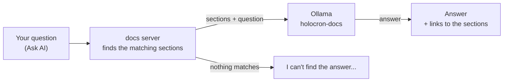

# Ask the docs (AI chat)

> **For:** anyone who would rather ask than search. **Result:** the **Ask AI** box of this site
> answers from these pages, with a small model that runs on your laptop.

The chat is in the docs on your laptop (`pnpm docs:serve`), not in the
[published docs](../7-maintain/publish-the-docs.md).

Type a question in the **Ask AI** box at the top right of any page. The answer
comes from these docs only, ends with links to the sections it used, and the same question gets the
same answer. When the docs do not cover it, the answer starts with the same sentence, followed by
the closest sections:

```text
I can't find the answer to that in the documentation.
```

By default nothing leaves your laptop (a cloud model is an opt-in, see
[Use Claude or OpenAI instead](#use-claude-or-openai-instead)): the docs server finds the sections that match the question and hands
them to the model, which runs in [Ollama](https://ollama.com) on your machine. The chat refuses to
send them anywhere else (see [What stays on your laptop](#what-stays-on-your-laptop)).



## Set it up once

`setup.cmd` does it ([Install](01-install.md)): it installs Ollama with scoop, downloads
`qwen3.5:2b` (about 2 GB, once) and makes `holocron-docs` from it with
`docs/theme/chat/Modelfile`. `setup.cmd -SkipDocsChat` leaves it out.

`pnpm docs:serve` starts Ollama in the background when it is not running, so there is nothing to
keep open. To redo the model by hand: `ollama pull qwen3.5:2b`, then `pnpm docs:model`.

## What to expect

- **It is small.** Qwen3.5 2B (Alibaba, 2026) runs on a laptop without a graphics card, but it can
  misread a section. The chat turns its "thinking" step off: the sections are already in front of
  it, and thinking would make each answer much slower. Check what it
  says against the linked section before you run a command it gives.
- **It knows the docs, not your code.** Ask how to do something the docs describe; for an error in
  your feature, see [troubleshooting](../9-help/troubleshooting.md).
- **One question at a time.** It reads the question before yours to understand a follow-up such as
  "and in test?", nothing earlier. Click **+** at the top of the chat to start again.
- The conversation is kept until the docs server stops.

## When it does not answer

| The chat says | Do |
|---|---|
| Ollama is not running at http://127.0.0.1:11434 | run `setup.cmd`; if Ollama is installed, restart `pnpm docs:serve` |
| Ollama has no model "holocron-docs" | run `setup.cmd`, or `ollama pull qwen3.5:2b` then `pnpm docs:model` |
| `ollama pull` says the model needs a newer version of Ollama | `scoop update ollama`, then run `setup.cmd` again |
| ... is an Ollama cloud model / only uses an Ollama on this computer | remove `DOCS_CHAT_MODEL` / `OLLAMA_HOST`: the chat refuses anything that is not on your laptop |
| The docs assistant works on this computer only | open the docs at `http://localhost:5173`, not through another address |
| ... needs ANTHROPIC_API_KEY / OPENAI_API_KEY | set the key in the terminal and restart `pnpm docs:serve`, or remove `DOCS_CHAT_PROVIDER` |
| ... refused the credentials. Open Claude Code / Codex and send it any message | the login expired: do that, then ask again |
| Claude Code's login only works with Haiku models | remove `DOCS_CHAT_MODEL`, or use `claude` with an API key |
| I can't find the answer to that in the documentation. | ask with the words the docs use (a command, a page title), or search with the box at the top left |

## Use Claude or OpenAI instead

By default the chat uses Ollama, on your laptop. To answer with a cloud model instead, set
`DOCS_CHAT_PROVIDER` in the terminal before `pnpm docs:serve`. **This sends each question and the
(up to six, against three for the local model) docs sections found for it to that company.** Nothing is sent unless you set it.

| `DOCS_CHAT_PROVIDER` | Uses | Needs | Default model |
|---|---|---|---|
| `ollama` (default) | the model on your laptop | Ollama ([set up](#set-it-up-once)) | `holocron-docs` |
| `claude` | the Claude API | `ANTHROPIC_API_KEY` | `claude-haiku-5-5` |
| `claude-login` | the login of Claude Code | being signed in to Claude Code | `claude-haiku-5-5` (Haiku models only) |
| `openai` | the OpenAI API | `OPENAI_API_KEY` | `gpt-6-luna` |
| `openai-login` | the ChatGPT login of Codex | being signed in to Codex with ChatGPT | `gpt-6-luna` |

```powershell
$env:DOCS_CHAT_PROVIDER = "claude"; $env:ANTHROPIC_API_KEY = "sk-ant-..."; pnpm docs:serve
```

With a cloud provider, `pnpm docs:serve` does not start Ollama, and if one is already running it
asks it to drop `holocron-docs` from memory, so the local model does not use your RAM.

`DOCS_CHAT_MODEL` picks another model (for `claude-login`, it must be a Haiku model: Anthropic
accepts no other with that login).

<Warning>
The two `-login` modes reuse the login that Claude Code and Codex keep in
`~/.claude/.credentials.json` and `~/.codex/auth.json` (moved by `CLAUDE_CONFIG_DIR` and
`CODEX_HOME`). They are not documented ways to call these services, so they can stop working, and
the providers' terms for such logins may not allow every use: check them, or use an API key. The
chat only reads these files; it never writes or renews them. When a login has expired or is
refused, the chat tells you to open Claude Code or Codex and send it any message, which renews it.
</Warning>

## What stays on your laptop

With the default `ollama` provider, the model is a file of numbers: it cannot open a web page by itself. What could send your words
out is Ollama or the way it is called, so the docs server checks both before each question:

- **Ollama on this computer only.** `OLLAMA_HOST` must be `127.0.0.1`, `localhost` or `::1`; any
  other address is refused. Ollama is started listening on `127.0.0.1`, so other machines cannot
  reach it either.
- **A model stored here.** Ollama can also run *cloud* models (names ending in `cloud`), which send
  the prompt to ollama.com. The chat asks Ollama about the model first and refuses a cloud model.
- **No tools.** The model is given no tools, so it cannot ask for a web search or a page.

Ollama itself goes online only for `ollama pull`. The checks are in
`docs/theme/chat/local-only.mts`, and `test/unit/docs-chat/local-only.test.ts` proves them.

## Settings

Set these in the terminal before `pnpm docs:serve`, or once in a `.env` file in the project
folder: copy `.env.example` to `.env` and remove the `#` of the lines you want. `.env` is never
committed (keep your keys there, not in a page), and a value set in the terminal wins over the file.

| Variable | Default | What it changes |
|---|---|---|
| `DOCS_CHAT_PROVIDER` | `ollama` | `claude`, `claude-login`, `openai` or `openai-login` send the question and the sections found to the cloud ([above](#use-claude-or-openai-instead)) |
| `ANTHROPIC_API_KEY`, `OPENAI_API_KEY` | not set | the key for `claude` and `openai` |
| `OLLAMA_HOST` | `http://127.0.0.1:11434` | where Ollama runs |
| `DOCS_CHAT_MODEL` | `holocron-docs` | the model, after `ollama pull <model>`: `qwen3.5:4b` answers better but slower; `gemma4:e2b` (Google) is another choice. The rules and settings are sent with each question, so any local model gets them |
| `DOCS_AI_CHAT` | on | `off` hides the chat; `pnpm docs:webresources` and `pnpm docs:pages` set it for the [published docs](../7-maintain/publish-the-docs.md) |
| `DOCS_CHAT_PACE_MS` | `25` | milliseconds between the words of an answer as it appears; `0` shows them as the model writes them |
| `DOCS_CHAT_DEBUG` | not set | `1` prints, in the `pnpm docs:serve` terminal, each question, the sections the model read and what it wrote: to see why an answer is wrong |

```powershell
$env:DOCS_CHAT_MODEL = "qwen3.5:4b"; pnpm docs:serve
```

The rules the model follows are in `docs/theme/chat/prompt.mts` and the Modelfile. The local model
gets short, strict rules (two to five sentences, the best section last); a cloud model gets its own,
longer ones (`CLOUD_SYSTEM_PROMPT`): it may write a complete code example, combine several sections
and say what the docs do not cover, and it is still held to the docs. How this site
calls it is in [Write the docs](../7-maintain/write-the-docs.md#the-ai-chat).
