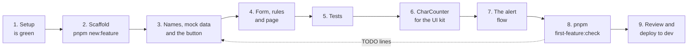

# Your first feature

> **For:** a new student who has finished the [setup](../2-set-up/01-install.md).
> **Result:** a tested **Callback request** dialog and the **flow** that reacts to it, built by you, and a
> check that prints **READY**. **Time:** about a day, with a mentor nearby.

The worked example in [Build a feature](../4-build/build-a-feature.md) shows how a feature is
built. This exercise proves that **you** can build one: a different task, with a description
instead of code, and a command that checks the result. When it prints READY and your mentor has
reviewed the code, you are ready for a real task.

## The task in one paragraph

On a **contact**'s form, a command opens a dialog that creates a **Callback request** linked to that
contact: a topic, a priority, a preferred date, a phone number (only asked for an urgent request) and
notes. Its rules are small but real: lengths, a date that cannot be in the past, a phone number that
looks like one. You also build one small piece for the shared UI kit: a character counter under the
notes. Then a **flow** emails the contact's owner when an Urgent request is created. Everything runs on
mock data and tests, so you need no table in Dataverse until the last step.

*The nine steps. The check sends you back to whichever step its TODO lines name.*

| # | You do | Proof it is done |
|---|---|---|
| 1 | Finish the setup | `setup.cmd -Doctor` shows no **FAIL** line |
| 2 | Create the feature | `pnpm test` passes on the scaffold |
| 3 | Point it at your table, add the mock data and the button | the preview opens your page from a contact |
| 4 | Build the form, the rules and the page | the preview behaves as the brief says |
| 5 | Write the tests | `pnpm test` and `pnpm test:e2e` pass, with your tests in them |
| 6 | Build `CharCounter` | it is in `src/ui`, tested, and shown under the notes |
| 7 | Write the alert flow and its tests | `pnpm flows:build` and `pnpm test:flows` pass |
| 8 | Run the check | `pnpm first-feature:check` prints **READY** |
| 9 | Show your mentor, then deploy | a review, then the feature and the flow work in the dev environment |

## How to work

- Use the documentation: [Build a feature](../4-build/build-a-feature.md) and
  [Build a flow](../5-flows/build-a-flow.md) are your step lists, their worked examples show each
  pattern, and the [reference](../8-reference/web-resources/feature-files.md) answers details. Copying a pattern
  is the point; pasting the Site visit code does not fit this task.
- Work in small steps and run `pnpm test` after each one. A red test you just caused is the easiest to fix.
- Keep `pnpm dev` running and `http://localhost:5600/?feature=callback-request` open: the page
  reloads on every save, and the unit tests rerun in the same terminal.
- Stuck for more than half an hour on one thing? Ask. Say what you expected, what happened, and paste
  the message.

## In this guide

- [1. The brief](first-feature/01-brief.md): the table, the rules and what "done" means
- [2. Build it](first-feature/02-build.md): steps 1 to 4, with hints
- [3. Test it and build the component](first-feature/03-tests-and-component.md): steps 5 and 6
- [4. The alert flow](first-feature/04-alert-flow.md): step 7
- [5. Check it and show it](first-feature/05-check-and-show.md): steps 8 and 9
- [For the mentor](first-feature/06-for-the-mentor.md): the review and the sign-off
