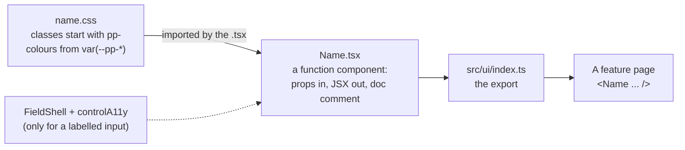

# Add a UI component

> **For:** when no existing component fits your page. **Result:** a tested component in
> `src/ui/`, ready to use in any feature.

First check [UI components](../8-reference/web-resources/ui-components.md) and
[lists, tables, charts, dialogs and tabs](../8-reference/web-resources/ui-components-data.md): a field, list,
table, chart, dialog or tab component probably already does it, and most variations are an option
(`readOnly`, `extraOptions`, `hint`...). Add a component only when the page needs something new
that more than one page could use. A piece used by one page only belongs in that feature, in
`page/<part>/` (same shape: a `.tsx` and a `.css`).

`src/ui/` is part of the shared kit. In a project made from the starter, a component every project
could use belongs in the starter and reaches the projects with `pnpm kit:update`. If you built it in
your project, `pnpm kit:status` lists it and `pnpm kit:push --pr` sends it to the starter as a pull
request ([update the kit](../7-maintain/update-the-kit.md),
[send kit changes back](../7-maintain/send-kit-changes-back.md)).

## The rules a component follows



*The files of a component, and who uses them.*

| Rule | Why |
|---|---|
| A folder `src/ui/<name>/` with `<Name>.tsx` and, if it needs styles, `<name>.css` | markup and look stay separate and readable |
| Markup is JSX; styles only in the `.css`; no `style={...}`, no HTML strings | `test/unit/conventions.test.ts` fails the build otherwise |
| Props describe what the component shows; the page holds the state | the component is a function of its props: easy to test, easy to reuse |
| A labelled input is built inside `FieldShell` with `controlA11y` | label, hint, required marker, error and `aria-*` wiring come for free and look the same everywhere |
| Class names start with `pp-`; colours and spacing are `var(--pp-*)` | a feature restyles a page by setting the variables |
| No table or column names inside; take them as props | the kit stays project-independent |
| A doc comment on every function, interface and type | ESLint fails the build when one is missing |
| Export from `src/ui/index.ts`, test in `test/unit/ui/`, add a row to the reference | so others find it and it stays working |

## The steps

1. Write the `.css` (if any) and the `.tsx`; the `.tsx` imports the `.css`, which is how the build
   knows to ship it.
2. Export it from `src/ui/index.ts`.
3. Show it. In the starter, add a panel to the example feature, in
   `src/features/quick-task/page/showcase/`, and list it in the tabs of `Showcase.tsx`. In a project,
   use it in your own page; the example feature is not part of the kit, so whoever reviews the pull
   request adds its showcase panel in the starter.
4. Test it in `test/unit/ui/<name>.test.tsx`.
5. Add a row to [UI components](../8-reference/web-resources/ui-components.md) (fields, layout, saving, feedback) or
   to [lists, tables, charts, dialogs and tabs](../8-reference/web-resources/ui-components-data.md).
6. Check it:

```powershell
pnpm type-check
pnpm lint            # the React hooks and accessibility rules run here
pnpm test            # includes the conventions test: no HTML strings or inline styles
pnpm dev             # see it in a page: http://localhost:5600/?feature=<feature>
```

## Two worked examples

They are teaching examples, not part of the kit: build them in a scratch feature to follow
along, and delete them afterwards (they do not go in the showcase). The code is real: it
type-checks, passes the linter and its tests pass. `Notice` is a simpler version of the kit's
`Alert`.

1. [A display component](add-a-ui-component/01-display-component.md): `Notice`, a message box
2. [A field](add-a-ui-component/02-field.md): `PhoneField`, an input with a typed value, and a
   field that loads its options

**Next:** [Build a feature](build-a-feature.md) · [UI components reference](../8-reference/web-resources/ui-components.md)
