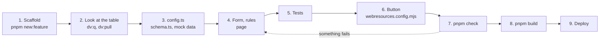

# Build a feature

> **For:** adding a command and its dialog to a model-driven app. **Result:** a tested, built
> feature with its command button described, ready to [deploy](../6-ship/deploy.md).

A feature is a folder in `src/features/<name>/`: a command-bar button that opens a React dialog
page. The steps below are the whole path. The [worked example](#the-worked-example-site-visit)
does every step for a real dialog, with all its code. File details are in
[feature files](../8-reference/feature-files.md), the form components in
[UI components](../8-reference/ui-components.md).



*The nine steps. Until step 9 nothing changes in Dataverse; step 2 only reads it.*

## 1. Create it

```powershell
pnpm new:feature site-visit "Site visit"
pnpm test
```

This creates `src/features/site-visit/` (a working dialog that creates a task linked to the
record it is opened from), `test/unit/site-visit.test.tsx`, `test/e2e/site-visit.spec.ts`, and
adds `"site-visit"` to `features` in `webresources.config.mjs`. Everything passes straight away.

Start the preview and keep it open while you work:

```powershell
pnpm dev                      # preview and docs, in one terminal
pnpm dv:preview site-visit    # or the preview alone
```

Open `http://localhost:5600/?feature=site-visit`. Pick a source record at the top; the page
opens as it would in the dialog. It reloads on every save. Writes appear in the log panel and in
the terminal; nothing is sent anywhere.

## 2. Look at the real table

Before changing code, look at the table in dev ([read real data](read-real-data.md)):

- its logical name, entity set name and the columns you will write:
  `pnpm dv:pull <table> --columns a,b,c` prints them as a `config.ts` block;
- the options of its choice columns (`dv:pull` lists them too);
- in Power Apps, on the table: its primary name column, and under **Relationships** the
  navigation property of the lookup to the source record (case-sensitive).

## 3. Point the feature at it

1. **`config.ts`**: set `target.table`, `target.columns` and `sourceBinding`. Every Dataverse name
   the feature uses is written here and nowhere else.
2. **`schema.ts`**: it is built from `config.ts`; add the choice values the code compares
   against, records it finds by name, and N:N relationships it links through.
3. **Mock data**: add the table and its choices to `tools/preview/mock-data.json` (the preview)
   and `test/fixtures/mock-data.json` (the tests). `pnpm dv:pull ... --into <file>` writes them
   for you ([format](../8-reference/mock-dataverse.md#data-file-format)). Add the source table to
   `sources` if the dialog opens from a table the preview does not offer yet.
4. `pnpm test:dataverse`: dev has every table and column you named.

## 4. Build the form

1. **`page/fields.ts`**: describe the fields with the builders (`text`, `choice`, `lookup`,
   `date`, `checkboxes`, ...): id, label, whether required, where the options come from.
2. **`logic/rules.ts`**: validation as a pure function that returns `{ field, message }`, so the
   message shows under the right field. Pass today's date in, so a test can pin it.
3. **`page/<Name>Page.tsx`**: lay the fields out with `Page`, `Section`, `Row` and
   `<Field name="..." />`; the page keeps values, errors and loaded options in state and loads
   the lists in one effect.
4. Say which fields are only sometimes asked in **one** `isVisible` function. Give it to
   `FormContext` (then `<Field>` draws nothing for a hidden field) and to `checkRequired`: a field
   that is not shown is never required.
5. Map the values to columns in `toPayload()`, the only place values meet column names.
6. Put follow-up writes (N:N links, child records) in the `createThen` callback, so a failure
   removes the half-saved record.

Try each rule in the preview and read the payload in the log panel.

## 5. Test it

Rewrite the generated tests as the feature changes: the rules first, then the page's load, save
and failure paths, then the main path in the browser. [Test and check](test-and-check.md) says
which test proves what and how to write each one.

## 6. Describe the command button

Add the button to `buttons` in `webresources.config.mjs`:

```js
  buttons: {
    "site-visit": { label: "Site visit", table: "account" },
  },
```

`label` and `table` are required. `location` is `"form"` (the default) or `"grid"`; `function` is
the exported function to run (default `open`). A list of buttons puts the same command on several
tables. The build checks each button against the functions `command.js` really exports
([configuration](../8-reference/configuration.md)).

## 7. Check it

```powershell
pnpm check          # format, lint, types, unit tests with coverage, flows, docs
pnpm test:e2e       # the browser tests, when a page changed
```

The same checks run in the git hooks and in CI ([the checks](test-and-check/02-the-checks.md)).

## 8. Build it

```powershell
pnpm build
```

It formats, lints and type-checks, then writes:

| Output | For |
|---|---|
| `dist/<prefix>_<feature>_` | the web resources: `command.js`, `page.js`, `page.html`, `page.css` |
| `webresources.links.xml` | the Web Resources Manager in XrmToolBox: which file is which web resource |
| `dist/deploy.json` | the Command Buttons tool (the buttons from step 6) and `pnpm dv:verify` |

It also prints each command's **Library** and **Function** (here `SiteVisit.open`), and any
problem with `buttons`.

## 9. Deploy it

[Deploy](../6-ship/deploy.md) pushes the web resources, creates the button and checks dev. The
first time, follow [Deploy your first solution](../6-ship/deploy/01-first-time.md).

## Other shapes

| Need | Change |
|---|---|
| A command with no dialog | delete the `page/` folder; the build skips missing files |
| A form script (OnLoad, OnChange) | export functions from `command/index.ts`; register `<Name>.<function>` on the form event with "Pass execution context as first parameter" |
| A dialog that edits the current record | read it with `getXrm().WebApi.retrieveRecord`, save with `updateRecord` |
| A component the form needs | [Add a UI component](add-a-ui-component.md) |

## Mistakes people make

| Symptom | Cause |
|---|---|
| The status line shows the options of a select, or "Saved" never appears | a field uses an id the kit already uses (`status`, `save`, `openRecord`, `fillTestData`) |
| Saving fails with a Dataverse error naming a property or navigation property | the lookup's navigation property has the wrong letter case, or the source table differs from the one the binding is for |
| A choice shows "Loading..." forever, or no options | the column name is wrong, or the mock data has no `"<table>.<column>"` entry for it; the status line names the list that failed |
| Saving is blocked on a field the user cannot see | the field is hidden some other way than `isVisible`; let `isVisible` decide both what is drawn and what is required |
| The linter says "React Hook ... has a missing dependency" | add it to the dependency array (or move the code out of the effect); do not silence the rule |
| A test warns "not wrapped in act(...)" | something changed state without being awaited; wait with `waitFor` or `findBy...` |
| A filter returns every row in the preview | the fake supports only `eq` / `ne` joined by `and` ([mock Dataverse](../8-reference/mock-dataverse.md)) |
| The build warns about `buttons.<feature>` | the feature is not in `features`, `command.js` does not export that function, or `label` or `table` is missing |

## The worked example: Site visit

On an account's form, a command opens a dialog that creates a **Site visit** with its inspectors.
The code is real: it type-checks, passes the linter, and its unit and browser tests pass.

1. [Scaffold, config and schema](build-a-feature/01-scaffold-and-config.md)
2. [Rules, fields and the page helpers](build-a-feature/02-rules-fields-page.md)
3. [The page component and mock data](build-a-feature/03-page-and-mock-data.md)
4. [Tests](build-a-feature/04-tests.md)
5. [Button and build](build-a-feature/05-button-and-build.md)

Then build one yourself: [Your first feature](../3-first-feature/first-feature.md).
