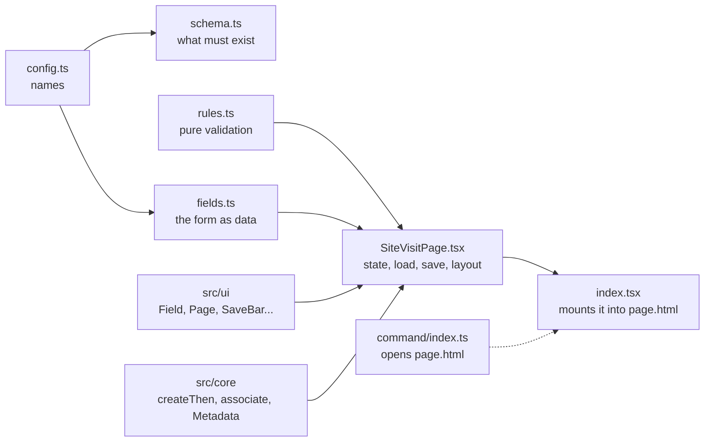

# Build a feature: 1. Scaffold, config and schema

> Part 1 of 5 of the worked example in [Build a feature](../build-a-feature.md).

**The task.** On an account's form, a command opens a dialog that creates a **Site visit**
(`pidev_sitevisit`) linked to that account. The user gives a name, a date and a status. If the
status is *Cancelled*, a reason is required. The user also ticks the inspectors (system users),
linked through an N:N relationship. If linking fails, the visit must not be left behind.

"Site visit" is a teaching example; it is not part of the project. The table and column names are
examples: use the real ones from your environment ([read real data](../read-real-data.md)).



*The files you will touch. The command needs no change.*

## 1. Scaffold

```powershell
pnpm new:feature site-visit "Site visit"
```

The scaffold creates, ready and passing:

```
src/features/site-visit/
  config.ts                 every Dataverse name the feature uses
  schema.ts                 what pnpm test:dataverse checks in the real environment
  command/index.ts          the command-bar button: SiteVisit.open
  page/index.tsx            the page's entry point: mounts React (do not edit)
  page/SiteVisitPage.tsx    the form: state, load, validate, save, layout
  page/fields.ts            the fields as data
  page/page.html            the page's shell: a <div id="root">
  page/page.css             the page's own styles (optional)
  logic/rules.ts            pure functions: values and validation
test/unit/site-visit.test.tsx
test/e2e/site-visit.spec.ts
```

and adds `"site-visit"` to `features` in `webresources.config.mjs`. The pieces are explained in
[feature files](../../8-reference/web-resources/feature-files.md). Check it works before changing anything:

```powershell
pnpm test
pnpm dev        # then open http://localhost:5600/?feature=site-visit
```

## 2. Say what the feature uses: `config.ts`

Every table, column and special choice value is written once, here. Start from the real names:

```powershell
pnpm dv:pull pidev_sitevisit --columns pidev_name,pidev_visitdate,pidev_status,pidev_cancelreason
```

It prints the `target` block and the options of `pidev_status`. Replace the scaffold's `target`
and `sourceBinding`, and add the two names the page needs:

```ts
  /** The table the page creates a record in, and the columns it writes. */
  target: {
    table: "pidev_sitevisit",
    columns: {
      name: "pidev_name",
      visitDate: "pidev_visitdate",
      status: "pidev_status",
      cancelReason: "pidev_cancelreason",
    },
  },

  /** The status option that asks for a reason. The other options come from the column's metadata. */
  statusCancelled: 3,

  /** The inspectors are linked through an N:N relationship to the system users. */
  inspectors: { table: "systemuser", relationship: "pidev_sitevisit_inspectors" },

  /** The lookup that links the visit to the account the dialog was opened from. */
  sourceBinding: "pidev_Account@odata.bind",
```

- `statusCancelled` is the one option value the code compares against. The other options of
  the status column are never written in code: the page loads them from the table's metadata.
- The lookup's navigation property (`pidev_Account@odata.bind`) and the N:N relationship name are
  not in `dv:pull`'s output: find them in Power Apps, table > **Relationships**. The navigation
  property is **case-sensitive**.

## 3. Say what must exist: `schema.ts`

```ts
/**
 * @file schema.ts
 * @description What the Site visit feature expects to find in Dataverse. `pnpm test:dataverse`
 * checks every feature's schema.ts against the real environment, so a renamed column or a
 * deleted choice is caught before users see it.
 */

import type { FeatureSchema } from "@core/schema";
import { SiteVisitConfig as Config } from "./config";

const { table, columns } = Config.target;

export const schema: FeatureSchema = {
  feature: "site-visit",
  tables: [{ table, columns: Object.values(columns) }],
  // The page compares the status against the Cancelled option, so that value must exist.
  choices: [{ table, column: columns.status, values: [Config.statusCancelled] }],
  relationships: [{ schemaName: Config.inspectors.relationship }],
};
```

`pnpm test:dataverse` checks all of this against dev, read-only: the table and columns exist, the
Cancelled option exists, the N:N relationship exists. If someone renames a column, this fails
before your users notice.

---

**Previous:** [Build a feature](../build-a-feature.md) · **Next:** [2. Rules, fields and the page helpers](02-rules-fields-page.md)
