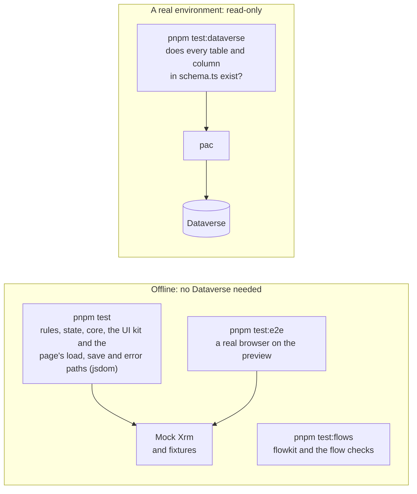

# Test and check

> **For:** knowing which test proves what, writing them, and passing the checks every change
> meets. **Result:** a change that is green on your machine and therefore green in CI.

## Which test for what



*What each test layer talks to.*

| Layer | Command | Proves | Needs |
|---|---|---|---|
| Unit | `pnpm test` | rules, the form state, core helpers, the UI components, a page's load, save and error paths | nothing |
| Browser | `pnpm test:e2e` | the page works when a user clicks it in a real browser | Microsoft Edge |
| Flows | `pnpm test:flows` | flowkit and the flows build and pass their checks | Python (installed by setup) |
| Dataverse | `pnpm test:dataverse` | the environment has every table, column and choice the code uses | pac signed in |

Put each case in the cheapest layer that can prove it: edge cases and rules in unit tests, one
user journey per page in the browser, names in `schema.ts`. `pnpm check:all` runs the first three
(unit tests with coverage). `pnpm test:dataverse` runs against dev after you change names, and
against each environment before you deploy ([read real data](read-real-data.md#3-keep-checking-with-pnpm-testdataverse)).

## The checks

```powershell
pnpm check          # format, lint, types, unit tests with coverage, flow checks, docs build
pnpm test:e2e       # also, when a page changed
```

The same checks run three times: the **pre-commit** hook formats what you staged, the
**pre-push** hook runs `pnpm check`, and **CI** runs them all on the pull request. A green
`pnpm check` means a green pull request.

## In this guide

1. [Write tests](test-and-check/01-write-tests.md): the rules, the page on the mock, the browser,
   `schema.ts`, bug fixes and coverage
2. [The checks](test-and-check/02-the-checks.md): every check, the git hooks, CI, documentation
   comments, and what to do when one fails

**Next:** [Build a feature](build-a-feature.md) · [Deploy](../6-ship/deploy.md)
