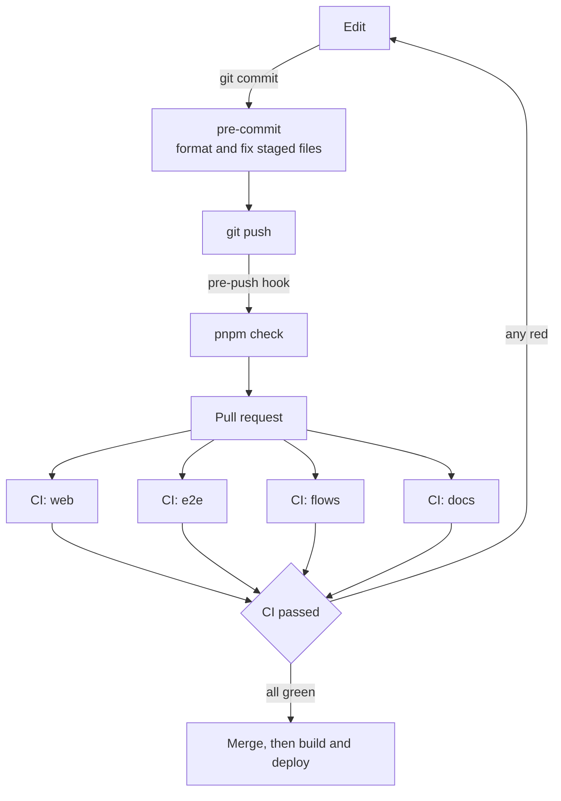

# Test and check: the checks

> Part 2 of 2 of [Test and check](../test-and-check.md). **For:** knowing what is checked before a
> change reaches Power Platform, how to run the checks yourself, and what to do when one fails.

## The checks

| Check | Tool | Command | What it catches |
|---|---|---|---|
| Formatting, web | Prettier (`.prettierrc.json`) | `pnpm format:check` (`pnpm format` fixes) | style differences; one format for TypeScript, CSS, HTML, JSON, YAML |
| Lint, web | ESLint, `typescript-eslint` strict + stylistic, type-aware | `pnpm lint` (`pnpm lint --fix`) | unsafe `any`, unhandled promises, needless conditions, `==`, unused code |
| React hooks and accessibility, web | ESLint with `eslint-plugin-react-hooks` (including the React Compiler checks) and `eslint-plugin-jsx-a11y` | `pnpm lint` | a hook called conditionally, an effect with a missing dependency, state set during render, an input without a label, a click handler on a non-interactive element |
| Documentation, web | ESLint with `eslint-plugin-jsdoc` | `pnpm lint` | a function, class, method, interface or type in `src/` without a doc comment |
| Types, web | `tsc` (strict) | `pnpm type-check` | type errors in `src/`, `test/` and the configs |
| Unit and component tests | Vitest and Testing Library, coverage by V8 | `pnpm test:coverage` | broken behaviour; coverage below the floor in `vitest.config.mts` |
| Browser tests | Playwright | `pnpm test:e2e` | a page that no longer works in a real browser |
| Formatting, Python | Black | `pnpm format:flows:check` (`pnpm format:flows` fixes) | style differences in `flows/` |
| Lint, Python | Ruff | `pnpm lint:flows` (`pnpm lint:flows --fix`) | unused imports, import order, likely bugs, simplifications |
| Documentation, Python | Ruff, rules `D` | `pnpm lint:flows` | a module, class, function or method in `flows/` without a docstring |
| Types, Python | Pyright, strict | `pnpm type-check:flows` | type errors; `Any` and ignore comments are not accepted |
| Flow rules | `flowkit.check()` and tests | `pnpm flows:build`, `pnpm test:flows` | a wrong `runAfter`, an unknown action name, an uninitialized variable or one initialized inside a scope, `null()`, an unknown expression function, unbalanced brackets, `items()` outside its loop |
| Docs | Holocron, and `docs-site.test.ts` | `pnpm docs:build`, `pnpm test` | a page that does not parse, a broken link or heading link, a page missing from the menu |
| Commands | `commands.test.ts` | `pnpm test` | a `pnpm <name>` shown in the docs that is not a script; a flow test that `pnpm test:flows` would skip (outside the folder it searches, or in a folder without `__init__.py` or with a dash in its name) |

Prettier and Black only format. They cannot know that a function has no comment; ESLint (web) and
Ruff (Python) check that, and they fail the build the same way a type error does.

## Run everything before you push



*A change meets the same checks three times: on commit, before push, and in CI. Only a green CI can merge.*

```powershell
pnpm check
```

It runs `check:web` (format, lint, types, tests with coverage), `check:flows` (Black, Ruff, Pyright, flow
tests) and `docs:build`. Add `pnpm test:e2e` when a page changed. To fix what can be fixed
automatically: `pnpm format`, `pnpm lint --fix`, `pnpm format:flows`, `pnpm lint:flows --fix`.

## Git hooks

`pnpm install` installs two git hooks (simple-git-hooks):

- **pre-commit** formats and fixes only the files you staged (lint-staged), so a commit is never
  badly formatted.
- **pre-push** runs `pnpm check`. A push with a failing check is stopped before it leaves your machine.

In an emergency `git push --no-verify` skips the hook. CI still runs, and a failing CI cannot be merged.

## CI on GitHub

`.github/workflows/ci.yml` runs on every pull request and every push to the default branch:

| Job | Runs |
|---|---|
| `web` | install with the lockfile, Prettier, ESLint, `tsc`, unit tests with coverage, the build; uploads `dist/` |
| `e2e` | the Playwright tests in Chromium; uploads the report when one fails |
| `flows` | Black, Ruff, Pyright, the flow tests, the build of the project's flows; uploads `flows/out/` |
| `docs` | `pnpm docs:build` |
| `CI passed` | fails when any job above failed, was cancelled or was skipped |

Other workflow: `release.yml` builds a release when a `v*` tag is pushed
([Make a release](../../6-ship/release.md)).
Dependabot and CodeQL are off: the starter has no `.github/dependabot.yml`, so no dependency pull
requests are opened, and no `codeql.yml`, because code scanning in a private repository needs GitHub
Code Security. Add either file back (and list it in `kit.json`) if a project wants it.

### Make CI a gate (once, by a repository admin)

In GitHub: **Settings > Branches > Add branch protection rule** for `main`:

- Require a pull request before merging.
- Require status checks to pass, and select **CI passed**.
- Require branches to be up to date before merging.

Now nothing reaches the branch your Power Platform solutions are built from without passing every check.

## Documentation comments

Every function, class, method, interface and type alias in `src/` has a doc comment that says what it
is for and **when** to use it. Every module, class, function and method in `flows/` has a docstring.
Tests do not need them: a test name already says what it checks.

```ts
/** The value of a lookup as `{ id, name }`, or null when it is empty. Use it to read, not to write. */
export function readLookup(record: DataRecord, column: string): LookupValue | null {
```

```python
def compose(value: Json, after: RunAfter | None = None) -> Action:
    """Compose: evaluates `value` once and keeps it.

    Later actions read it with @outputs('<name>').
    """
```

With parameters, name each one in the doc comment (`@param name - what it is`); ESLint checks the names match.
No types in the TypeScript comments: the signature already has them.

## When a check fails

| Failure | Do |
|---|---|
| Prettier or Black | run `pnpm format` or `pnpm format:flows`, and commit the result |
| `react-hooks/exhaustive-deps` | add the missing value to the dependency array, or move the code so it does not need it |
| `jsx-a11y/*` | give the control a label or a role, or use the right element (`<button>` for a click) |
| `jsdoc/require-jsdoc` or Ruff `D1xx` | write the comment; do not disable the rule |
| `no-unsafe-*` or `no-explicit-any` | give the value a real type, or read it as `unknown` and narrow it |
| `no-floating-promises` | `await` it, return it, or end it with `.catch(...)` |
| Coverage below the floor | add tests for the new code; raise the floor in `vitest.config.mts` when coverage grows |
| Pyright | fix the type; ignore comments are not accepted |
| `flowkit.check()` | the message names the action and the problem; see [Write the steps of a flow](../../5-flows/build-a-flow/01-write-the-steps.md) |

Do not silence a rule with a comment (`eslint-disable`, `@ts-ignore`, `# noqa`, `# type: ignore`).
If a rule is wrong for the whole project, change it in `eslint.config.mjs` or `pyproject.toml` in a
pull request of its own, with the reason written next to it.

## Versions

- `typescript` is pinned to `~6.0` because `typescript-eslint` supports a given range of TypeScript
  versions. When a new `typescript-eslint` supports the next one, bump both together.
- Python tools are in `pyproject.toml` and locked in `uv.lock`; web tools in `package.json` and
  `pnpm-lock.yaml`. CI installs from the lockfiles (`--frozen-lockfile`, `--frozen`), so it builds
  exactly what you tested.

---

**Previous:** [1. Write tests](01-write-tests.md)
