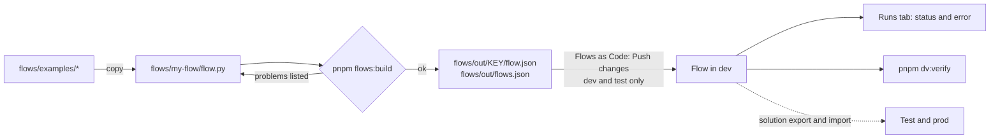

# Build a flow

> **For:** adding or changing a Power Automate cloud flow. **Result:** a flow written in Python,
> checked by `pnpm flows:build`, pushed to dev, run once, and confirmed with `pnpm dv:verify`.

You write flows in Python with `flowkit`, not in the designer. The flow is reviewed in git, built
the same way for every environment, and checked before it reaches Dataverse. This page is the whole
path. The sub-pages are the craft of writing the steps.



*From a Python file to a running flow. The designer is for reading runs, not for editing.*

## 1. Start from an example

Copy the example closest to what you need into a new folder under `flows/`:

```powershell
Copy-Item flows\examples\overdue-tasks flows\my-flow -Recurse
```

| Example | Shows |
|---|---|
| `flows/examples/overdue-tasks` | One file: a weekday schedule, a Dataverse query with `$expand`, a loop, an Outlook email, `catch()` and `terminate_with_list()`. |
| `flows/examples/stale-visits` | A flow split into modules (`settings.py`, `expressions.py`, `steps/`). It is walked through in [A complete example](build-a-flow/02-complete-example.md). |
| `flows/examples/intake-webhook` | A web address other systems call: an HTTP trigger, a `switch`, `try_catch` and a `response` in both outcomes. |

Then change `name`, `key` (PascalCase, unique: it names the output folder and the connection
references) and `description` in `Flow(...)`.

## 2. Write the steps

Write the steps in words first, then turn each one into a named action in `chain({...})`.
How to do that, in order:

- [Write the steps](build-a-flow/01-write-the-steps.md): how a flow's files are organized, the method, adding a step.
- [A complete example](build-a-flow/02-complete-example.md): every file of `stale-visits`.
- [Rules and testing](build-a-flow/03-rules-and-testing.md): which action to use, the rules, unit tests.
- [Flow patterns](flow-patterns.md): every building block (triggers, loops, switch, try/catch, email, HTTP),
  each with a flow that builds.
- [Environment variables](environment-variables.md): a value that differs per environment (a mailbox, a URL),
  read through a parameter and set after the import.
- [Choice values](choice-values.md): a choice column's number, looked up at run time by its English label.

Every helper is in the [flowkit reference](../8-reference/flows/flowkit.md); the expression syntax is in
[Flow expressions](../8-reference/flows/flow-expressions.md).

## 3. Build and check

```powershell
pnpm flows:build                                 # every flows/<name>/flow.py
uv run python flows/build-all.py flows/my-flow   # just one, checks and output only
```

`pnpm flows:build` formats (Black), lints (Ruff) and type-checks (Pyright) the Python, then runs
`flowkit.check()` on every flow. Folders under `flows/examples/` are not built unless you name them.
If anything is wrong, nothing is written and each problem is listed as `<flow name>: <problem>`.
It catches the mistakes Power Automate would otherwise show only when it saves or runs the flow:

| The build says | What is wrong | Fix |
|---|---|---|
| `runAfter 'X' is not in the same scope` | an action waits on one outside its loop, condition or scope | move one of them, or wait on an action in the same scope |
| `no action starts the scope` | every action in a scope waits on another | let `chain()` order them; remove the stray `after=` |
| `outputs('X'): no action or trigger has that name` (also `body`, `items`, `actions`, `result`) | a typo, or the action was renamed | use the name constant from `expressions.py` |
| `variables('X'): not initialized` (also Set, Append, Increment, Decrement) | no `init_variable` for it | add `init_variable("X", kind)` at the top |
| `Initialize variable must be at the top level` | `init_variable` inside a loop, condition or scope | move it to the top-level `chain()` |
| `items('Loop'): used outside the 'Loop' loop` | the loop's current item is read after the loop | inside the loop, save the value in a variable |
| `toTitle(): not a Power Automate expression function` | a function that does not exist (names ignore case) | check [Flow expressions](../8-reference/flows/flow-expressions.md) |
| `'(' and ')' do not match`, `'[' and ']' do not match`, `a quote is not closed` | an expression is unbalanced | count the brackets inside the `@{...}` it shows |
| `null(): there is no null() function` | `null()` in an expression | write the literal `null` |
| `a Terminate cannot evaluate variables()` | a Terminate message reads a variable | use `terminate_with_list()` |

When the build succeeds it writes:

| File | What it is for |
|---|---|
| `flows/out/<key>/flow.json` | the flow as Power Automate stores it: the file you push. Never edit it; rebuild. |
| `flows/out/flows.json` | each flow's key, name, workflow id and the solutions it is in, read by `pnpm dv:verify` |
| `flows/flows.links.json` | the links Flows as Code reads: each built flow's id, name, `file` and description are added or updated; other entries are kept ([format](../8-reference/project/configuration.md#flowslinksjson)). Written only by the default `flows/out` build. |
| `flows/out/<Solution>_<version>.zip` | one solution to import per solution in `flows/solution.json`, one way to create the flow the first time ([first time](../6-ship/deploy/04-flow-and-try.md#4-the-flow)) |

It also prints the connection references each flow needs. The solution's publisher, prefix and
version come from `flows/solution.json`. A flow in two solutions gets the same `flow.json` in both
zips, so it is one flow in the environment. Setting up several solutions:
[One flow in several solutions](../6-ship/deploy.md#one-flow-in-several-solutions).

## 4. Push and run in dev

The [Flows as Code plugin](../8-reference/tools/flows-as-code.md) for XrmToolBox pushes
`flow.json` to the flow in Dataverse, without exporting or importing a solution.
`tools\xrmtoolbox\install.cmd` installs it.

1. **First time only:** create the flow in your dev solution from its file: the build has added it to
   `flows.links.json`, so **More > Create new flows...** (it creates the missing connection references and environment variables too; connect them before turning the flow on).
   Or import the zip from step 3 once and set a connection on each connection reference
   ([Deploy, step 4](../6-ship/deploy/04-flow-and-try.md#4-the-flow)).
2. In XrmToolBox, connect to dev, open **Flows as Code**, pick the solution, and **Link to existing
   file**: `flows/out/<key>/flow.json`. The build already sets `buildCommand` to `pnpm flows:build` in
   `flows.links.json` (you allow it once), so every push rebuilds first.
3. **Push changes**. The plugin checks the file (valid JSON, a trigger, `runAfter` in the same block,
   every connection declared), turns the flow off, updates it, and turns it back on. If turning it
   back on fails, it says the flow is OFF.
4. Start a run: cause the trigger (create the row, press the button) or **Run** it in Power Automate
   (the plugin has an **Open in Power Automate** button).

The plugin works on dev and test only and refuses production. Flows reach test and prod inside the
solution, like everything else ([Deploy](../6-ship/deploy.md)). If you change the flow in the
designer, copy the change back into `flow.py`, or the next push overwrites it.

## 5. See the run and its error

In **Flows as Code**, open the **Runs** tab. It lists recent runs of the loaded flows: flow, status,
start, duration, trigger and error.

- Show **all** runs or **failed** only, over the last 1 to 60 days (7 by default). Failed runs are red.
- Double-click a run to open it in Power Automate. Every action shows its inputs, outputs and status;
  the first red action is the one that failed.
- **Copy error** (Ctrl+C) copies what to send when you ask for help.

The tab reads the Flow Run table: it keeps runs for 28 days, needs read access, and only covers flows
in solutions. When it is empty or not readable, the tab says so, and the flow's run history in Power
Automate shows the same runs. The tab has not yet been tried against a real environment.

A run that fails with only "BadRequest" usually lacks `catch()` and `terminate_with_list()`: with
them, the run's error lists every problem ([Rules](build-a-flow/03-rules-and-testing.md)).

## 6. Verify the environment

```powershell
pnpm dv:verify                  # the environment pac is signed in to
pnpm dv:verify --env <org url>  # another one
```

It reads `flows/out/flows.json` and checks, read-only through `pac`, that each flow exists (by
workflow id or name) and is **on**. It checks the web resources and buttons of `dist/deploy.json` at
the same time, so run `pnpm build` once first: without `dist/deploy.json` it stops. Each line says
`ok`, `NO` or `?`. See [Deploy: verify](../6-ship/deploy.md#5-verify).

**Next:** [Write the steps](build-a-flow/01-write-the-steps.md) · [Deploy](../6-ship/deploy.md)
