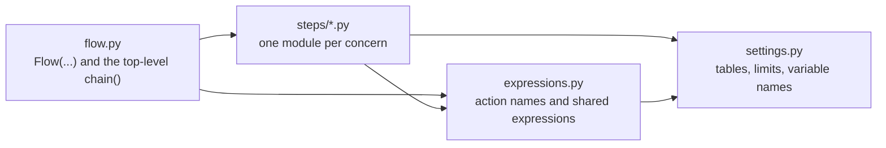
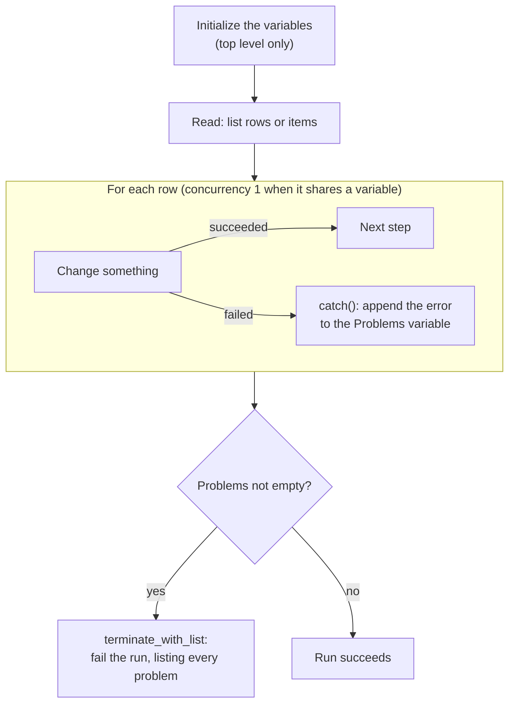

# Build a flow: Write the steps

> **For:** writing a flow's actions correctly from the first line. **Result:** a flow that passes
> `pnpm flows:build` and runs the first time. Part 1 of 3 of [Build a flow](../build-a-flow.md).

## How a flow is organized

A small flow is one file, `flows/<name>/flow.py`. Once it has more than a handful of actions, split
it by **concern**, not one file per action:

```text
flows/stale-visits/
  flow.py          the flow's name, trigger and the order of its steps
  settings.py      tables, limits, variable names: the only file to edit to retarget the flow
  expressions.py   action names (as constants) and the expressions the steps share
  steps/
    find.py        what to read
    close.py       what to change
    report.py      how a run ends
```



*Who imports whom.*

- `flow.py` reads like the designer's canvas: the order of the steps.
- Each module under `steps/` holds the actions of one concern.
- Each name is written once, as a constant in `expressions.py`. The step that declares an action and
  the expression that reads its output (`outputs(LIST_STALE)`) cannot drift apart.
- The build loads the flow's folder as a package, so modules use relative imports
  (`from .steps.find import list_stale_visits`, `from ..settings import VISIT_SET`).

[A complete example](02-complete-example.md) shows every file of this layout.

## The method, in order



*The usual shape: one bad row is recorded, the loop carries on, and the run ends by listing every problem.*

1. **Write the steps in words**: the trigger, then verbs and objects. "Every day at 6: find the
   Planned visits older than 30 days; close each; if any close failed, fail the run listing them."
2. **Name each step `Verb_object`** with underscores (`List_stale_visits`, `Close_visit`). The run
   history shows this name, and other steps refer to it.
3. **Declare each action as a Python variable** in a `steps/` module:
   `list_stale_visits = dataverse(...)`.
4. **List the variables in `chain({...})` in run order.** `chain()` makes each action wait for the
   one before it, so you write `runAfter` (`after=`) only for exceptions.
5. **Put anything used twice in `expressions.py`** (an action name, `items('For_each_...')`, a date
   cutoff) and anything you might change in `settings.py`.
6. **Run `pnpm flows:build` after every few steps.** A wrong reference stops at your desk, not at
   run time ([what it catches](../build-a-flow.md#3-build-and-check)).

## Add a step to an existing flow

1. Pick the module by concern, or add one under `steps/`.
2. If any expression will read the step's output, add its name as a constant in `expressions.py`.
3. Declare the action as a variable in the module.
4. Add `NAME: variable,` to the `chain()` in `flow.py`, where it should run. If it belongs inside a
   loop or a condition, add it to that block's own `chain()` instead.
5. Run `pnpm flows:build`. Each problem names the action and what is wrong.
6. Push and run it ([Build a flow, step 4](../build-a-flow.md#4-push-and-run-in-dev)), then read the
   run in the Runs tab.

---

**Previous:** [Build a flow](../build-a-flow.md) · **Next:** [A complete example](02-complete-example.md)
