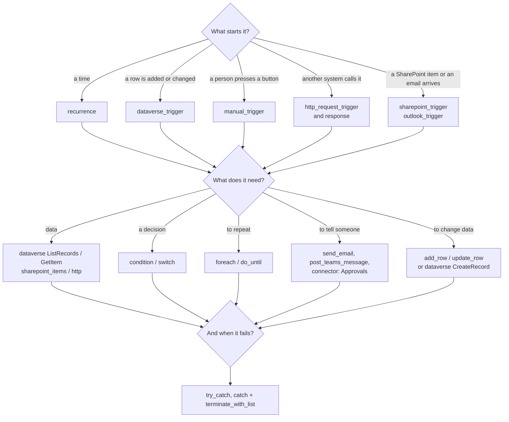

# Flow patterns

> **For:** choosing the trigger, actions and structure of a flow before you write it. **Result:** the
> building block for each need, with a whole flow you can copy.

This is the catalogue of what a flow can be made of. [Build a flow](build-a-flow.md) is the path
(write, build, push, run). There are hundreds of connectors, but the same few blocks cover almost
every flow. Every `flow = Flow(...)` block in these pages is run by `pnpm test:flows`, so it builds
and passes `check()`.

*A flow is a trigger, some of the blocks in the middle, and a plan for failure.*

## Which block for which need

| I want to… | Use | Where |
|---|---|---|
| run every day or week | `recurrence` | [Triggers](flow-patterns/01-triggers-and-data.md#triggers) |
| react to a new or changed row, but only some | `dataverse_trigger` with `filter_expression` / `filter_columns` | [Triggers](flow-patterns/01-triggers-and-data.md#triggers) |
| be called by another system and answer it | `http_request_trigger` + `response` | [Triggers](flow-patterns/01-triggers-and-data.md#triggers) |
| react to a new SharePoint item or email | `sharepoint_trigger`, `outlook_trigger` (+ `trigger_options` to filter) | [Helpers for common connectors](flow-patterns/05-connectors.md#helpers-for-common-connectors) |
| read rows, or one row, or a related row | `dataverse("ListRecords" / "GetItem")` | [Reading and writing Dataverse](flow-patterns/01-triggers-and-data.md#reading-dataverse) |
| create or update a row, with a lookup | `add_row` / `update_row`, or `dataverse("CreateRecord" / "UpdateOnlyRecord")` | [Reading and writing Dataverse](flow-patterns/01-triggers-and-data.md#writing-dataverse) |
| do one of two things | `condition` | [Decisions](flow-patterns/02-decisions-and-loops.md#decisions) |
| do one of several things by a value | `switch` | [Decisions](flow-patterns/02-decisions-and-loops.md#decisions) |
| do something for each row | `foreach` | [Loops](flow-patterns/02-decisions-and-loops.md#loops) |
| wait for something to become true | `do_until` + `delay` | [Loops](flow-patterns/02-decisions-and-loops.md#loops) |
| count, build a text, collect problems | variables | [Variables](flow-patterns/03-variables-and-failure.md#variables) |
| do two things at once | `parallel(...)`, or two actions after the same one | [Parallel branches](flow-patterns/03-variables-and-failure.md#parallel-branches) |
| handle a failure and carry on, or fail clearly | `try_catch`, `catch`, `terminate_failed` | [Try, catch, finally](flow-patterns/03-variables-and-failure.md#try-catch-finally) |
| send an email or a Teams message | `send_email`, `post_teams_message` | [Helpers for common connectors](flow-patterns/05-connectors.md#helpers-for-common-connectors) |
| ask for an approval | `connector(...)` | [Teams and approvals](flow-patterns/06-teams-and-web.md#teams-and-approvals) |
| use an action no helper covers | `connector(...)` with its JSON from the designer | [Find the JSON of any action](flow-patterns/05-connectors.md#find-the-json-of-any-action) |
| call a web service and read its answer | `http` + `parse_json` | [Web services](flow-patterns/06-teams-and-web.md#web-services) |
| make a run reliable and cheap | filters, concurrency, limits | [Reliability](flow-patterns/04-reliability.md) |
| retry a call, limit its time, hide its data in the run history | `with_options` | [flowkit options](../8-reference/flowkit-options.md) |

Every helper and its arguments are in the [flowkit reference](../8-reference/flowkit.md); the
expressions inside actions (`@{formatDateTime(...)}`) are in [Flow expressions](../8-reference/flow-expressions.md).

## In this guide

- [1. Triggers and Dataverse data](flow-patterns/01-triggers-and-data.md)
- [2. Decisions and loops](flow-patterns/02-decisions-and-loops.md)
- [3. Variables, branches and failure](flow-patterns/03-variables-and-failure.md)
- [4. Reliability and cost](flow-patterns/04-reliability.md)
- [5. Connectors](flow-patterns/05-connectors.md)
- [6. Teams, approvals and web services](flow-patterns/06-teams-and-web.md)
