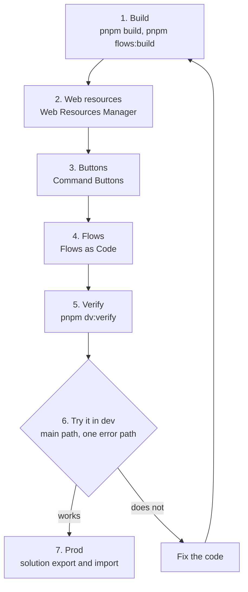

# Deploy

> **For:** putting a feature or a flow in dev, checking it is there, then moving it to prod.
> **Needs:** System Customizer in dev, pac signed in, the XrmToolBox tools installed.
> **Result:** the work runs in dev, and prod gets it by solution import.

Everything goes into the project's **unmanaged solution in dev**. Test and prod receive that
solution by export and import (or your organization's pipeline), never by hand edits.

**First time?** The pieces do not exist yet in Dataverse, and a few steps happen only once.
Follow [The first time](deploy/01-first-time.md) with a mentor, then come back to this loop.



*The deploy loop. Steps 2 to 4 push to dev only.*

## Before you start

| Check | How |
|---|---|
| pac is signed in to **dev** | `pac org who` ([install and sign in](../2-set-up/01-install.md)) |
| You can work there | `pnpm dv:access`: you exist, are enabled, have System Customizer, and the project's publisher and solution exist |
| The XrmToolBox tools are installed | `tools\xrmtoolbox\install.cmd` ([XrmToolBox tools](../8-reference/tools/overview.md)) |
| The code is ready | `pnpm check` passes (the git hooks and CI run it too) |

`pnpm dv:access new.student@example.com` checks someone else (it needs read access to users and
roles), and `--roles "System Customizer,Basic User"` changes the roles it expects. Every `dv:`
command takes `--env https://<org>.crm3.dynamics.com` to look at another environment than pac's
current one, and only reads. If access is the problem, read [access and security](../9-help/access-and-security.md)
before you try anything else.

## 1. Build

```powershell
pnpm build              # format, lint, type-check, then dist/
pnpm flows:build        # if you changed flows
```

`pnpm build` writes `dist/`, `webresources.links.xml` (for the Web Resources Manager) and
`dist/deploy.json` (for Command Buttons and `dv:verify`). It prints every web resource and the
entry point of each command library, read from the built `command.js`:

```text
  pidev_quick_task_command.js
  pidev_quick_task_page.js
  pidev_quick_task_page.html
  pidev_quick_task_page.css

Command entry points (command designer: Library and Function):
  Library  pidev_quick_task_command.js
  Function QuickTask.open
```

`pnpm flows:build` writes `flows/out/<key>/flow.json` for each flow and `flows/out/flows.json`
(for `dv:verify`), and lists the connection references each flow needs.

## 2. Push the web resources

In XrmToolBox, connect to dev and open the **Web Resources Manager**. **Push changes** runs
`pnpm build`, shows what changed, pushes and publishes.

This needs the links file once per computer: **Link files** > **Use a links file...** >
`webresources.links.xml`. A feature whose web resources do not exist yet is created first with
**Open > Local folder...** > `dist` ([the first time](deploy/03-web-resources-and-button.md)).

## 3. Create or update the buttons

Describe each button in `webresources.config.mjs` (`buttons`) and build. In XrmToolBox open
**Command Buttons**, pick the project folder, the app and the solution, check the state of each
button (*Missing*, *Up to date*, *Different*...), then **Publish selected**. It creates or updates
the buttons and publishes the app; it never deletes one
([states and settings](../8-reference/tools/overview.md#command-buttons-deployjson)).

A button only changes when its label, table or entry point changes. Most deploys skip this step.

## 4. Push the flows

In XrmToolBox open **Flows as Code**, pick the solution, and **Push changes**. Each linked
`flows/out/<key>/flow.json` is checked, then the flow is turned off, updated and turned back on.
Linking a file, `buildCommand` and creating a new flow:
[Build a flow](../5-flows/build-a-flow.md#4-push-and-run-in-dev).

If someone changed the flow in the designer, copy the change into `flow.py` first, or the push
overwrites it.

## One flow in several solutions

A flow belongs to a solution by **membership**. Each solution has its own zip, and the zip of a
solution holds the flows that are its members. A flow is not copied: it is built once
(`flows/out/<key>/flow.json`), and every zip that holds it carries that same JSON. In the environment
the flow is one workflow, with one id, in each solution that holds it.

- **Home and prefix.** The top-level object of `flows/solution.json` is the home solution. Every
  flow is built with the home's prefix, so its connection references (`<prefix>_<Flow><Connector>`)
  and environment variables keep that prefix in every solution. An extra solution may have another
  prefix; build-all then prints a warning, because the shared flow keeps the home's prefix.
- **Fixed workflow_id.** A flow in two or more solutions must set `workflow_id` in its `flow.py`.
  Without one its id is derived from the home solution's unique name, so renaming the home solution,
  or moving the flow to another home, would create a new flow. build-all stops and names the
  solutions.
- **Membership in the file.** List a flow's folder in the `flows` of each solution that should hold
  it, in `flows/solution.json` ([configuration](../8-reference/project/configuration.md#flowssolutionjson)),
  then run `pnpm flows:build`. Build one solution with
  `uv run python flows/build-all.py --only-solution <uniquename>`.
- **In the environment.** The file only shapes the zips. To change which solutions hold a flow in
  dev or test, use Flows as Code: right-click > **Add to solution...** or **Remove from this
  solution** ([Solutions of a flow](../8-reference/tools/flows-as-code.md#solutions-of-a-flow)).
  Moving a flow is both: add it to the new solution, then remove it from the old one.

## 5. Verify

```powershell
pnpm dv:verify
```

It reads `dist/deploy.json` and `flows/out/flows.json` from the last builds and checks that each
web resource exists with exactly the built name, each button exists, and each flow exists and is on:

```text
ok  Web resource    pidev_quick_task_command.js                 exists
NO  Web resource    pidev_quick_task_page.css                   missing: upload it
ok  Command button  Quick task (account)                         exists
NO  Flow            Overdue task reminder                        exists but is off
```

It cannot see whether a web resource was **published**. If everything exists and you still see the
old version: **Publish all customizations**, then Ctrl+F5.

## 6. Try it in dev

Open a record, press Ctrl+F5, click the button. Go through the main path and one error path, and
look at the saved record. For flows, open the **Runs** tab of Flows as Code: each run, its status
and its error ([when a flow fails](when-a-flow-fails.md)).

Something wrong: fix the code and go round the loop again. The symptom table is in
[troubleshooting](../9-help/troubleshooting.md).

## 7. Prod

The XrmToolBox tools refuse production. Prod gets the solution:

1. Check prod has what the code uses:
   `$env:DATAVERSE_URL="https://<prod-org>.crm3.dynamics.com"; pnpm test:dataverse`
2. Raise the solution version in dev (and `version` in `flows/solution.json`).
3. **Publish all customizations**, export the solution (managed, unless your organization says
   otherwise), and import it in prod, or run the pipeline.
4. Set prod connections for the flows and turn them on.
5. Smoke-test with a test record, then delete it. `pnpm dv:verify --env <prod url>` confirms
   every piece arrived.

Managed or unmanaged, import order, the smoke test and how to go back:
[export, import, go back](deploy/05-export-import.md).

**Next:** hand the project over with [make a release](release.md).
