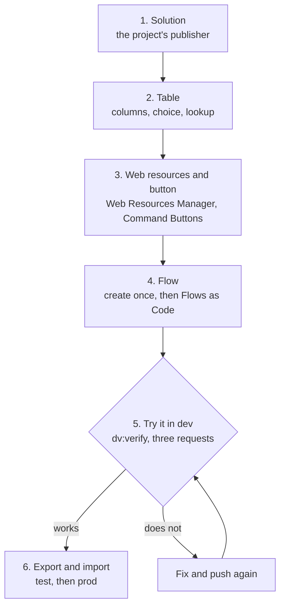

# Deploy: the first time

> **For:** a student who has finished [Your first feature](../../3-first-feature/first-feature.md)
> and has never put anything in a Power Platform environment. **Needs:** a dev environment where
> you are System Customizer, and a mentor beside you. **Result:** the *Callback request* exercise
> runs in dev, and you know how it reaches test and prod.

The code on your laptop does nothing for anyone until it is **in Dataverse**. The first time, the
pieces do not exist yet: you create the publisher's solution, the table, the web resources, the
button and the flow once. After that, every change goes round the short [deploy loop](../deploy.md).

*The first deployment. Steps 1 to 5 happen in dev.*

## The words you need

| Word | Meaning |
|---|---|
| Environment | one copy of Dataverse with its own data and URL: dev, test, prod |
| Solution | a box that holds the pieces of one piece of work (tables, web resources, flows). It is what moves between environments |
| Publisher | who owns the pieces; its **prefix** (`pidev`) starts every name you create |
| Unmanaged / managed | unmanaged can be edited (dev). Managed is locked and can be removed as a whole (test, prod) |
| Connection reference | the flow's "slot" for a login, so the same flow can use a different login in each environment |

More in [Power Platform for web developers](../../1-learn/01-power-platform.md) and the
[glossary](../../8-reference/project/glossary.md).

## The steps

| # | Step | Where | Page |
|---|---|---|---|
| 1 | Create the solution with the project's publisher | make.powerapps.com | [Solution and table](02-solution-and-table.md) |
| 2 | Create the table, columns, choice and lookup | make.powerapps.com | [Solution and table](02-solution-and-table.md#2-the-table) |
| 3 | Create the web resources, add the button | XrmToolBox | [Web resources and button](03-web-resources-and-button.md) |
| 4 | Import the flow once, then push it | make.powerapps.com, XrmToolBox | [Flow, then try it](04-flow-and-try.md) |
| 5 | Verify and try it in dev | your laptop, the app | [Flow, then try it](04-flow-and-try.md#5-try-it-in-dev) |
| 6 | Export, import in test, go back if broken | make.powerapps.com | [Export, import, go back](05-export-import.md) |

Something failed? Find the symptom in [troubleshooting](../../9-help/troubleshooting.md).

## Before you start

1. `pnpm first-feature:check` says READY (your code and tests are done).
2. `pac org who` shows your **dev** environment ([install and sign in](../../2-set-up/01-install.md)).
3. `pnpm dv:access` says ok for you, your role and the publisher (found by its prefix). It says NO
   for the solution of `flows/solution.json` until you import the flow in step 4: expected today.
4. The XrmToolBox tools are installed: `tools\xrmtoolbox\install.cmd`
   ([XrmToolBox tools](../../8-reference/tools/overview.md)). In XrmToolBox, create a connection to dev.
5. Ask your mentor **which solution layout your project uses**: one solution for tables, web
   resources and flows, or one for the data and one for the flows (`flows/solution.json`). These
   pages show the second, because that is what `pnpm flows:build` produces; with one solution, you
   add the flow to it in step 4.
6. Open [https://make.powerapps.com](https://make.powerapps.com), pick **dev** at the top right, and check its name every time
   you click something: most mistakes are made in the wrong environment.

**Screens change.** Microsoft renames buttons often. Each step says what it must achieve, so if a
button has moved, search for the word in bold, or ask your mentor.

**Next:** [Solution and table](02-solution-and-table.md).
