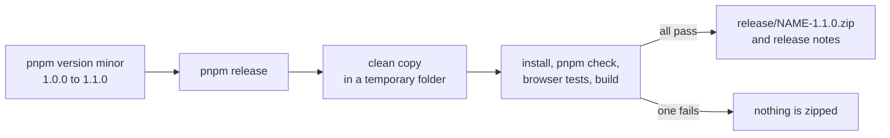

# Make a release

> **For:** handing the project to someone (a new student, another team, a reviewer) as a zip that
> is known to work. **Needs:** the project installed (`setup.cmd`), uv, a browser for the browser
> tests. **Result:** `release/<name>-<version>.zip` and its release notes.

A release is the code, not a deployment: Dataverse gets the work by [solution import](deploy.md#7-prod).
Never zip the folder by hand: `pnpm release` checks the project the way a new teammate would get it,
and writes the zip only when everything passes.



*What one release does.*

## 1. Choose the version

The version is the one in `package.json`. Change it with pnpm, which also commits and tags it in git
(the working tree must be clean):

```powershell
pnpm version patch     # 1.0.0 -> 1.0.1: fixes only
pnpm version minor     # 1.0.0 -> 1.1.0: something new
pnpm version major     # 1.0.0 -> 2.0.0: something people must change for
```

`pnpm version` first runs the upgrade check of the starter (several minutes): it simulates the update
of a project made from the previous release, and stops the version bump when that fails. In an
emergency, `pnpm version patch --ignore-scripts` skips it (then the tag is made, but nothing is checked).

## 2. Release

```powershell
pnpm release              # every check, the browser tests and the build
pnpm release --skip-e2e   # when no browser can run the browser tests
pnpm release --no-check   # zip only; the notes say it was not checked
```

It copies the project's files to a temporary folder and runs, there, one after the other:

| Step | Command |
|---|---|
| Install | `pnpm install --frozen-lockfile` |
| All checks | `pnpm check` (format, lint, types, tests with coverage, flow checks, docs build) |
| Browser tests | `pnpm test:e2e` (skipped with `--skip-e2e`) |
| Build | `node tools/build.mjs` |

You get two files in `release/` (git ignores the folder):

| File | Holds |
|---|---|
| `<name>-<version>.zip` | the project in a `<name>/` folder, plus `RELEASE.md` (the notes) |
| `<name>-<version>.md` | the notes: date, commit (with "+ uncommitted changes" if files differ from it), number of files, and each step with how long it took |

The project's files are what git tracks plus new files git does not ignore. Never `node_modules`,
`dist`, `.venv`, `site`, `release`, `out` folders or test results. Without git (an unzipped copy), it
takes every file except those folders and `*.log` files.

## 3. Or let GitHub do it

When the project is a GitHub repository, push the tag that `pnpm version` made:

```powershell
git push --follow-tags
```

The **Release** workflow (`.github/workflows/release.yml`) runs on every pushed `v*` tag, on a fresh
Linux machine:

1. checks the tag matches `package.json` (`v1.1.0` for `1.1.0`), and stops if not;
2. `pnpm install --frozen-lockfile`, then installs Chromium for the browser tests;
3. `pnpm release`;
4. publishes a GitHub Release named after the tag, with the zip attached and the notes as its text.

It has 30 minutes. If it fails, the run's log shows the step; fix it, then make a new version (`pnpm version patch`)
and push it.

## When it fails

The failing step prints its output, then `... failed. Nothing was zipped.` Run the same command in
your project (`pnpm check`, `pnpm test:e2e`), fix it, then `pnpm release` again. A failure that only
happens in the clean copy usually means a file is missing from git, or `pnpm-lock.yaml` does not
match `package.json`: `git status` shows the first, `pnpm install` fixes the second.

**Next:** projects made from this starter take its new version with
[update the kit](../7-maintain/update-the-kit.md).
