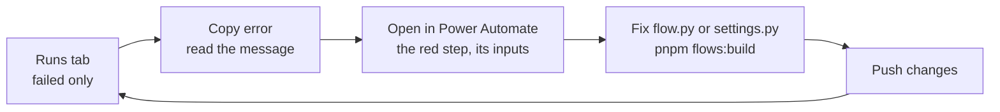

# When a flow fails

> **For:** a flow that did not run, or ran and failed, in dev or test. **Needs:** XrmToolBox with
> Flows as Code, and read access to the Flow Run table. **Result:** you know which run failed, at
> which step, and why.

*From a failed run to a fix.*

## 1. Find the run

In XrmToolBox, connect to the environment, open **Flows as Code**, load the solution and open the
**Runs** tab. It lists the recent runs of the loaded flows: flow, status, start, duration, trigger
and error.

| To | Do |
|---|---|
| See only what went wrong | choose **failed only** (failed runs are red) |
| Look further back | set the period, 1 to 60 days (default 7) |
| Send the error to someone | select the run, **Copy error** (Ctrl+C): it copies what a helper needs |
| See every step | double-click the run: it opens in Power Automate |

The tab reads the **Flow Run** table. Dataverse keeps runs there for **28 days** by default, only
for flows in solutions, and you need read access to it. When the tab is empty or cannot read the
table, it says so: then use the flow's **Run history** in Power Automate. The tab only reads, so it
works on any environment, prod included. It has not been tried on a real environment yet; if its
list looks wrong, trust Power Automate's run history.

## 2. Read the run

In Power Automate, the red step is the one that failed. Open it: its **inputs** show what the flow
sent, its **outputs** what came back. For a Dataverse step, the real reason is in the outputs at
`body.error.message`. A step wrapped with flowkit's `catch()` adds that message to a list, and the
run can end with `terminate_failed()` listing every problem: that is the error the Runs tab shows.

## 3. The usual errors

| Symptom or message | Cause | Fix |
|---|---|---|
| No run at all | the flow is Off, or the trigger's filter did not match | `pnpm dv:verify` shows whether it is on. Check `dataverse_trigger` scope and `filter_columns`, and that choice values are the numbers you expect (`2`, not `100000002`) |
| `InvalidTemplate` | an expression failed: wrong type, null, a bad date | read the red step's inputs. For SharePoint dates use `formatDateTime`, not `convertFromUtc` |
| Only "BadRequest" | Dataverse rejected the write | the step's outputs > `body.error.message`; it usually names the column |
| Failed at a *Get a row* step | wrong table set name or lookup name | fix `settings.py` (the set name is plural: `pidev_callbackrequests`; a lookup is read as `_pidev_contact_value`), build, push |
| `principal user ... is missing prv...` | the connection's account lacks a privilege | ask for the role on that account; do not switch to someone else's |
| Failed with your own code (for example `NoOwnerEmail`) | the flow's own rule stopped it | that is the flow doing its job: fix the data, or test with another record |
| Email not received | the connection's account has no mailbox, or the mail is in junk | open the *Send an email* step's outputs |
| Red warning on a step in the designer | the connection is invalid | open the step and pick a valid connection |
| Flow is Off after a push | turning it back on failed | the push result says why; turn it on in Power Automate |
| Flow is Off after an import | imported flows with new connections arrive Off | set the connections, then turn it on |
| My designer changes disappeared | the flow was pushed again from code | copy designer changes into `flow.py` before you push |

A problem `pnpm flows:build` reports (an unknown function, brackets that do not match, `items()`
outside its loop, a variable not initialized) never reaches Dataverse: the build stops and names
it ([what the build checks](../5-flows/build-a-flow/03-rules-and-testing.md)).

## 4. Fix and push again

Fix `flow.py` or `settings.py`, then **Push changes** in Flows as Code (with `buildCommand` set, it
runs `pnpm flows:build` first). Trigger the flow again and watch the Runs tab. In test or prod the
fix travels by a new solution version ([export, import, go back](deploy/05-export-import.md)): never
edit the flow there.

Still stuck: send the copied error, the environment and what you did. More symptoms in
[troubleshooting](../9-help/troubleshooting.md).
