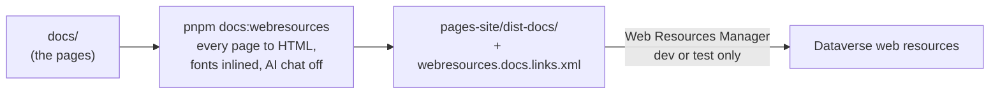

# Publish the docs

> **For:** whoever makes the docs readable outside a developer's laptop. **Needs:** the XrmToolBox
> **Web Resources Manager** connected to a dev or test environment. **Result:** the docs as
> Dataverse **web resources**, opened in a browser or embedded in a model-driven app, without the
> AI chat.

`pnpm docs:serve` shows the docs on your laptop only, and that is the best way to read them
([why](../index.md)). To let everyone else read them without running a server, the same pages are
built into plain files and uploaded to Dataverse as **web resources**: Dataverse serves the files
and Holocron's own scripts in the browser do the menu, the search and the diagrams.



## Build the web resources

```powershell
pnpm docs:webresources
```

It builds every page (the same prerender as `pnpm docs:build`), rewrites each one to run from
`/WebResources/<prefix>_docs`, inlines the fonts, leaves out the files Dataverse cannot serve, and
writes:

| In `pages-site/` | What it is |
|---|---|
| `dist-docs/` | one file per web resource: the home `<prefix>_docs.html`, every page under `<prefix>_docs/…`, and the scripts, styles and images |
| `webresources.docs.links.xml` | the Web Resources Manager links file: each web resource's name and the file to upload it from |

`<prefix>` is your project's customization prefix (the one in `dist/deploy.json`). `docs/` itself is
not changed, and a page that does not parse fails here as it does in `pnpm docs:build`.

## Upload them

Push the web resources to a **dev or test** environment with the XrmToolBox **Web Resources
Manager**, loading `webresources.docs.links.xml` (it lists every web resource and the file to take
it from). Never upload to production ([Access and security](../9-help/access-and-security.md)). Then
**Publish all customizations**. Run `pnpm docs:webresources` and upload again after a docs change.

It is a large set (one web resource per page, plus the shared scripts and styles), so the links
file is what makes pushing them together manageable.

Open the home page in a browser:

```
https://<your-org>.crm.dynamics.com/WebResources/<prefix>_docs.html
```

To put it inside a **model-driven app**, open the home web resource from a command or a subarea, for
example `Xrm.Navigation.navigateTo({ pageType: "webresource", webresourceName: "<prefix>_docs.html" })`
— the same mechanism a feature dialog uses.

## What is different from the docs on your laptop

- **Full-page navigation.** There is no server, so each link does a quick full-page reload instead
  of an instant in-page move, and the injected script keeps the sidebar's open sections across those
  reloads. For the full experience read the docs locally with `pnpm docs:serve` ([the note on the
  home page](../index.md)).
- **No AI chat.** It answers with Ollama on the reader's laptop, so it is off here
  ([Ask the docs](../2-set-up/03-ask-the-docs.md)).
- **Built, not live.** A change shows after the next `pnpm docs:webresources` and upload.

## Windows

Rendering the pages at build time is done by spiceflow (Holocron's server). Its version does not
load the built server on Windows, so `patches/spiceflow@1.26.0-rsc.21.patch` (listed in
`pnpm-workspace.yaml`) fixes that one line. After updating Holocron, check that
`pnpm docs:webresources` still runs on Windows; drop the patch once spiceflow fixes it.
