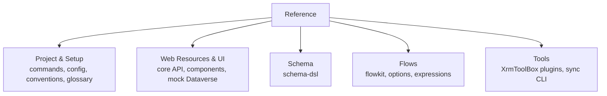

# Reference

> **For:** looking up exact formats, APIs, command flags, configurations and conventions.
> **Result:** you find the precise signature, file format or option you need without reading a full guide.

The guides in earlier sections (such as [Build a feature](../4-build/build-a-feature.md) and
[Build a flow](../5-flows/build-a-flow.md)) walk through step-by-step implementations.
This reference section contains the technical specifications, options, and contract definitions.

## Reference topics

### [Project & Setup](project/commands.md)

| Page | What it covers |
|---|---|
| [Commands](project/commands.md) | Every `pnpm`, `setup.cmd`, and `uv` command, its options and prerequisites |
| [Configuration](project/configuration.md) | Configuration file formats: `webresources.config.mjs`, `flows.links.json`, `dist/deploy.json`, etc. |
| [Conventions](project/conventions.md) | Naming rules, code style, git commit discipline, and architecture invariants |
| [Glossary](project/glossary.md) | Power Platform, Dataverse, and repository terminology defined |

### [Web Resources & UI](web-resources/core-api.md)

| Page | What it covers |
|---|---|
| [Core API](web-resources/core-api.md) | `@microsoft/power-platform-core` runtime helpers: Dataverse Web API client, current user, lookups |
| [UI components](web-resources/ui-components.md) | Form inputs, buttons, bilingual labels, and notification components |
| [Lists, tables, charts, dialogs](web-resources/ui-components-data.md) | Data displays, modals, tabs, and complex layout components |
| [Feature files](web-resources/feature-files.md) | Anatomy of a feature folder: `config.ts`, `schema.ts`, `formState.ts`, page components |
| [Mock Dataverse](web-resources/mock-dataverse.md) | Offline local mock Dataverse engine, test helpers, and seed data format |

### [Schema](schema/schema-dsl.md)

| Page | What it covers |
|---|---|
| [Schema DSL](schema/schema-dsl.md) | TypeScript DSL for defining tables, columns, choices, keys, and relationships in `schema/*.ts` |

### [Flows](flows/flowkit.md)

| Page | What it covers |
|---|---|
| [flowkit](flows/flowkit.md) | Python DSL for Power Automate cloud flows: `Flow`, `chain`, triggers, and connector actions |
| [flowkit options](flows/flowkit-options.md) | Action options (`retries`, `timeout`, `secure`), trigger options, and condition builders |
| [flowkit layout](flows/flowkit-layout.md) | Internal module structure of `flows/lib/flowkit/` for contributors and maintainers |
| [Flow expressions](flows/flow-expressions.md) | Power Automate workflow definition expressions syntax and built-in functions |

### [Tools](tools/overview.md)

| Page | What it covers |
|---|---|
| [XrmToolBox tools](tools/overview.md) | Overview of deployment tools and the safety model for dev and test environments |
| [Schema as Code](tools/schema-as-code.md) | Synchronizes `dist/schema.json` table and column definitions to Dataverse |
| [Web Resources Manager](tools/web-resources-manager.md) | Pushes and publishes compiled web resource bundles from `webresources.links.xml` |
| [Command Buttons](tools/command-buttons.md) | Synchronizes command bar buttons defined in `dist/deploy.json` into model-driven apps |
| [Flows as Code](tools/flows-as-code.md) | Pushes cloud flow definitions from `flows.links.json`, creates connections, and views run history |
| [OrgChart Manager Sync](tools/orgchart-manager-sync.md) | Previews and applies user manager hierarchy from company OrgChart into Dataverse |
| [OrgChart Sync (CLI)](tools/orgchart-sync.md) | Command-line crawler and sync plan generator behind OrgChart Manager Sync |

## Quick lookup

| I need to... | Read |
|---|---|
| Look up command flags or setup parameters | [Commands](project/commands.md) |
| Inspect the schema of a config file | [Configuration](project/configuration.md) |
| Verify project coding rules before code review | [Conventions](project/conventions.md) |
| Understand a term or acronym | [Glossary](project/glossary.md) |
| Query or mutate Dataverse records in React | [Core API](web-resources/core-api.md) |
| Pick an existing UI form input or button | [UI components](web-resources/ui-components.md) |
| Pick a grid, dialog, or chart component | [Lists, tables, charts, dialogs](web-resources/ui-components-data.md) |
| Check the required exports for a new feature | [Feature files](web-resources/feature-files.md) |
| Use mock Dataverse in unit or preview tests | [Mock Dataverse](web-resources/mock-dataverse.md) |
| Define a new table, column, or lookup in TypeScript | [Schema DSL](schema/schema-dsl.md) |
| Author a Power Automate flow in Python | [flowkit](flows/flowkit.md) |
| Add retry policies or trigger conditions to a flow | [flowkit options](flows/flowkit-options.md) |
| Write a Power Automate expression | [Flow expressions](flows/flow-expressions.md) |
| Deploy web resources, buttons, schema, or flows | [XrmToolBox tools](tools/overview.md) |
