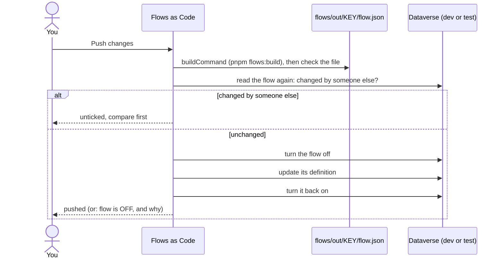

# Flows as Code

> **Reference.** The Flows as Code XrmToolBox tool, version 1.7.0: it pushes flow JSON files from
> the repo to the cloud flows of a Dataverse solution, without exporting and importing a solution,
> creates new flows from their files, adds flows to other solutions or removes them from one, and
> lists recent runs with their errors. Steps in order:
> [Build a flow](../../5-flows/build-a-flow.md#4-push-and-run-in-dev).

## Flows tab

| Action | Does |
|---|---|
| **Load flows** | **Flows of a solution...** or **All cloud flows of the organization**. The last solution reopens on connect; recent solutions are on the start page. |
| **Folder...** | the folder of the repo that holds the flow files and `flows.links.json` (the project's `flows` folder) |
| right-click > **Link to an existing file...** | links a flow to a file you already have: `out/<key>/flow.json` for this project |
| **Save to folder** | writes the environment's version of each flow as an indented `<flow name>.json` and links it; it also finds existing files and offers to link them |
| **Push changes** | pushes the linked files (below) |
| **More > Create new flows...** | creates the flows of the links file that the organization does not have yet, off, from their linked files (below) |
| **More > Turn on ticked flows** / **Turn off ticked flows** | turns the ticked flows on or off (the old Turn on / off dropdown is now under More) |
| **Compare** | your file against the environment's version (built in, or your own compare tool) |
| **Refresh from disk** | reads every linked file again |
| right-click > **Open in your editor**, **Open in Power Automate**, **Turn on** / **Turn off**, **Unlink** | as named |
| right-click > **Add to solution...** | adds the flows to one or more other unmanaged solutions, with their connection references and environment variables (below) |
| right-click > **Remove from this solution** | removes the flow from the loaded solution only; the flow stays in its other solutions (below) |
| **Settings** | **Build command...**, **Build folder...** (used when the links file has no `buildCommand`), **Editor command...**, **Compare tool...**, **Forget environment answers** |

The links go in [`flows.links.json`](../configuration.md#flowslinksjson), with paths relative to
it, so the team commits it. `pnpm flows:build` adds the flows it builds to the file; a flow you link
by hand (right-click > **Link to an existing file...**) keeps its own entry. Flow ids are the same in every environment the solution is imported to,
so one folder works for dev and test. Paths in the file can only point inside the folder.

Each row of the list shows:

| Column | Values |
|---|---|
| On / Off | whether the flow is turned on |
| Managed | managed flows are read-only here: change them where they are developed, then import the solution |
| State | *Same as the organization*; *Changed, not pushed* (blue); *Changed, has errors* (red); *Not saved to the folder* (gray) |

Tick flows to act on several at once; with nothing ticked, **Save to folder** acts on every flow
listed. Right-click > **Compare with organization** (or double-click) compares one. Save to folder
never overwrites a file with unpushed changes without asking, and leaves files that already hold
the same definition alone. **Unlink** forgets a link and keeps the file. Renaming a file means
changing its path in `flows.links.json` too.

### Watching files

The files are watched: a saved file shows *Changed, not pushed*. Indentation and line endings do
not count as changes, only the JSON content. The status bar shows **Watching N file(s)**; click it
to see the folders watched and the last change seen. A yellow bar names the files read again and how
many have errors. **Refresh from disk** reads every file again (after a git pull or a branch
switch). Settings > **Reopen last solution** turns off reopening the last solution on connect.

## What one push does

- **Build first**: the `buildCommand` of `flows.links.json` runs in the links file's folder before
  each push, once you allow it (and again whenever it changes). A failed build stops the push.
- **Checks**: valid JSON, a trigger, `runAfter` naming actions of the same block, every connection
  declared in `connectionReferences`. `pnpm flows:build` checks much more ([flowkit checks](../flowkit.md#checks)).
- **Off, update, on**: a flow that is on is turned off, updated, then turned back on (Dataverse does
  not accept a new definition for a flow that is on). A flow that is off is updated and stays off.
  If an update is refused, a flow that was on is turned back on with its previous definition. If
  turning it back on fails, the result says the flow is OFF, in red, until you fix it and turn it on.
  Runs already started finish with the previous definition.
- **Not tickable**: flows with errors, and managed flows.
- **Changed by someone else**: each flow is read again first; one changed since you loaded it is
  unticked and can be compared (**Compare...**); ticking it overwrites their change after you confirm.
- **Compare tool**: both sides are indented the same way before comparing, so only real changes
  show. Settings > **Compare tool...** sets your own (WinMerge, Beyond Compare, VS Code with
  `--diff`), used by **Open in compare tool** in the compare window.
- **Development and test only**: asked once per environment; production, and environments labelled
  PROD in XrmToolBox, are refused.

## Create new flows

**More > Create new flows...** creates the flows of `flows.links.json` whose id is not in the
organization yet, in the loaded solution. Each one is created **off**, from its linked file, with
the id of the links file, so the flow has the same id in every environment.

Before it creates a flow, the window also creates what the flow is missing in the solution:

- **environment variables**, from the flow file's parameters: display name, type, the default value
  (the development default that flowkit writes) and description;
- **connection references**, with no connection (connections are not stored in Dataverse).

The window lists the flows first. A flow that can be created is ticked, and its **Ready** column says
"Ready: creates first ..." with the names of the connection references and environment variables it
creates. A flow cannot be ticked (it is gray, and the **Ready** column says why) when:

- its file is missing or has errors;
- a flow with its id exists outside the loaded solution (add that flow to the solution instead).

The build command runs first, as in a push, and only in development and test, as in a push. A link
may carry an optional `"description"`, which is given to the new flow.

Before you turn the flow on, open the solution in Power Apps (dev), open each new connection
reference and pick a connection (signed in as you, or the project's service account).

The window's **Also add to other solutions...** button adds each created flow, with its connection
references and environment variables, to the solutions you choose (see below).

## Solutions of a flow

A flow can be in more than one unmanaged solution. Both menu items change only the membership: the
flow is never copied or deleted, so its id and run history stay.

- **Add to solution...** adds the selected flows to one or more other unmanaged solutions. By default
  (**Also add its connection references and environment variables**) it also adds the flow's own
  connection references and environment variables, found by name. It never uses Dataverse's "add
  required components", which would add whole tables. A reference or variable missing in the
  environment is reported, not created.
- **Remove from this solution** removes the flow from the loaded solution only. The flow stays, and
  stays in its other solutions, which the confirm window lists. It is refused when it is the flow's
  last solution: a flow outside every solution is invisible to the tool. Its connection references and
  environment variables are not removed, since other flows may use them.

Managed and system solutions (Default, Active, Basic) are never offered. Development and test only,
like push.

To move a flow from one solution to another:

1. Load the old solution (**Load flows**).
2. Right-click the flow > **Add to solution...** > the new solution.
3. Right-click the flow > **Remove from this solution**.

## Runs tab

The recent runs of the loaded flows, read from the Dataverse **Flow Run** table (`flowrun`).
Read-only, so it works on any environment, production included.

| Column | From `flowrun` |
|---|---|
| Flow, Status, Start, Duration, Trigger | `workflow`, `status`, `starttime`, `duration`, `triggertype` |
| Error code, Error message | `errorcode`, `errormessage` |

| Control | Choices |
|---|---|
| Show | **All runs** or **Failed only** |
| Last N days | 1, 3, 7, 14, 28 or 60; default 7 |
| **Failed first** | puts failed runs at the top (failed runs are red) |
| **Refresh** (F5) | reads the runs again |
| double-click a run | opens it in Power Automate, where each action shows its inputs and outputs |
| right-click > **Copy error** (Ctrl+C) | copies the flow, run, status, start, trigger, error code and message, and the run's address: what to send when you ask for help |

The newest 5,000 runs are shown at most. Dataverse keeps runs 28 days by default. Only flows in
solutions have runs there, and each flow owner needs read access on Flow Run for their runs to be
stored. The history can miss runs under heavy load: Power Automate's own run history is complete.
The query has not yet been tried on a real environment.

| The tab says | Cause |
|---|---|
| the run history cannot be read | cloud flow run history in Dataverse is off for the environment (Power Platform admin center > the environment > **Settings** > **Product** > **Features** > **Cloud flow run history in Dataverse**), or your role has no read access on Flow Run: ask your admin |
| no runs in the last N days | the flows did not run, the history keeps fewer days, or it was turned off |

Opening a run in Power Automate needs the environment id, which XrmToolBox knows for most connections.

## Limits

- Only flows inside Dataverse solutions (workflow records of category 5); not "My flows".
- New flows are created from linked files with **Create new flows** (it creates their missing
  connection references and environment variables too), or arrive with a solution import. It never
  creates flows outside a solution.
- A change made in the designer is overwritten by the next push: copy it back into `flow.py` first.

## Safety

The tool uses your XrmToolBox connection and rights. Nothing changes in the environment without
**Push changes**, **Create new flows** (for the flows you tick), **Add to solution...**, **Remove from
this solution**, **Also add to other solutions...**, or **Turn on** / **Turn off**; the Runs tab only
reads.
The build command, editor command and compare tool run on your computer with your rights; a build
command from the repo runs only after you allow it. Settings stay on your computer (folders,
environment answers, editor command). Also, **Open in your editor** uses `code` by default (change
it in Settings > **Editor command...**) and falls back to Notepad.

## Keys

Ctrl+F searches the flows by name, F5 reloads (on the Runs tab: reads the runs), F1 opens the help.

## Install

`tools\xrmtoolbox\install.cmd` ([XrmToolBox tools](../tools.md#install-or-update-them)); the zip
holds `FlowsAsCode.dll`.
