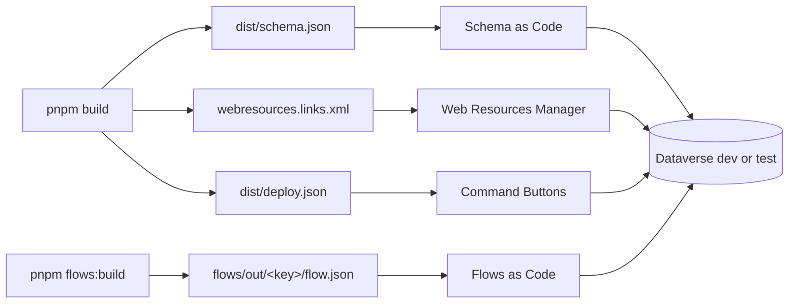

# XrmToolBox tools

> **Reference.** The XrmToolBox tools the team uses: four push to a development environment, a
> fifth sets user managers. What each reads, and how to install them. When to use the first four:
> [Deploy](../../6-ship/deploy.md).

| Tool | Version | Does | Reads from the project |
|---|---|---|---|
| [Schema as Code](schema-as-code.md) | 0.1.0 | creates and updates tables, columns, choices, status reasons, relationships and keys; deletes after confirmation | `dist/schema.json` |
| [Web Resources Manager](web-resources-manager.md) (team version) | 2.2026.9.25 | pushes and publishes changed web resources, running `pnpm build` first | `webresources.links.xml` |
| [Command Buttons](command-buttons.md) | 1.0.1 | creates or updates the command bar button of each feature in a model-driven app | `dist/deploy.json` |
| [Flows as Code](flows-as-code.md) | 1.7.0 | pushes `flow.json` files to existing flows (off, update, on), and creates new flows from linked files (off), with their missing connection references and environment variables; adds flows to other solutions or removes them from one; its **Runs** tab lists recent runs and their errors | `flows.links.json` |
| [OrgChart Manager Sync](orgchart-manager-sync.md) | 1.0.0 | previews, then sets each user's Manager from the company OrgChart; not part of a feature deploy | an OrgChart crawl or `orgchart-sync-plan.csv` |

The command-line tool behind it, which crawls the OrgChart and writes the plan, has its own page:
[OrgChart Sync (command line)](orgchart-sync.md).



*Each tool takes a file the build wrote and pushes it to a development or test environment.*

## Safety rules they share

- **Development and test only.** Each tool asks once per environment address whether it is dev or
  test and remembers the answer. Production is refused, and so is an environment labelled PROD in
  XrmToolBox. Production gets its changes by solution export and import
  ([Deploy](../../6-ship/deploy.md)). The Web Resources Manager asks this when you push to **another**
  environment from its push window; the environment you are connected to is not asked, so connect
  it to dev only.
- **They use your XrmToolBox connection** and your rights; they never ask for or store a password.
  Sign-in rules: [access and security](../../9-help/access-and-security.md).
- **A command from the repo runs only once you allow it**: the build command in a links file is
  shown and must be allowed the first time and whenever it changes.
- **Changes made by someone else are not overwritten silently**: each tool reads the environment
  again just before writing and leaves out, or asks about, what changed since.
- **A push never deletes anything** in the environment, except in Schema as Code: there, deletes
  are off until you allow them for that environment, and each one shows its data and asks you to
  type the environment's name.

## Tables: schema.json

`pnpm build` turns `schema/*.ts` ([Define the schema](../../4-build/define-the-schema.md)) into
`dist/schema.json` ([format](../project/configuration.md#distschemajson)). Schema as Code compares it with the
environment, shows a state per change, and pushes the ticked ones into the solution. See
[Schema as Code](schema-as-code.md).

## Web resources: the links file

`pnpm build` writes `webresources.links.xml` ([format](../project/configuration.md#webresourceslinksxml)).
The Web Resources Manager uses it to link every built file to its web resource and to run
`pnpm build` before each push. See [Web Resources Manager](web-resources-manager.md).

## Command buttons: deploy.json

The `buttons` of `webresources.config.mjs` ([format](../project/configuration.md#webresourcesconfigmjs)) end
up in `dist/deploy.json` ([format](../project/configuration.md#distdeployjson)). The Command Buttons tool
compares them with the app, shows a state per button, and creates or updates them. States, the
publish steps and the parameter format: [Command Buttons](command-buttons.md).

## Flows: flows.links.json

`pnpm flows:build` writes `flows/out/<key>/flow.json` and adds the built flows to `flows.links.json`.
Flows as Code links each file to its flow in it ([format](../project/configuration.md#flowslinksjson)), runs `pnpm flows:build` before each
push, and reads recent runs in its Runs tab. See [Flows as Code](flows-as-code.md).

## Install or update them

Close XrmToolBox completely, then from the project folder:

```powershell
pnpm xrm                                                              # updates tools and starts XrmToolBox
tools\xrmtoolbox\launch.cmd                                           # same as pnpm xrm
tools\xrmtoolbox\install.cmd                                          # update tools only without launching
tools\xrmtoolbox\install.cmd -Force                                   # re-download even if version matches
tools\xrmtoolbox\install.cmd -Zip C:\Downloads\FlowsAsCode-1.2.0.zip  # zips you downloaded
tools\xrmtoolbox\install.cmd -PluginsFolder D:\XrmToolBox\Plugins     # a portable XrmToolBox
```

| Option | Default | Meaning |
|---|---|---|
| `-Force` | false | re-download and overwrite even if the installed version is current |
| `-Zip <zip>` | none: download | install this zip instead of downloading (a local build, or when gh is not logged in) |
| `-PluginsFolder <dir>` | `%AppData%\MscrmTools\XrmToolBox\Plugins` | the Plugins folder; for a portable XrmToolBox, the one next to `XrmToolBox.exe` |

For each tool of [`tools/xrmtoolbox/tools.json`](../project/configuration.md#toolsxrmtoolboxtoolsjson) it
authenticates via GitHub CLI (`gh auth login`) or `$env:GH_TOKEN`, checks the latest release tag,
downloads any updated zip, removes copies left by earlier downloads (`FlowsAsCode (1).dll`),
copies the listed DLLs into the Plugins folder, unblocks them (Windows blocks downloaded DLLs
and XrmToolBox then skips them silently) and prints each version. Already up-to-date tools are
skipped for fast startup. No administrator rights are needed.

It stops when XrmToolBox is running, when the Plugins folder does not exist (start XrmToolBox
once), or when no zip held a listed DLL. A tool whose release cannot be downloaded is skipped with
a message: download its zip from the release page and pass it with `-Zip`.

The tools then show in XrmToolBox's **Tools** list, not in the Tool Library.
