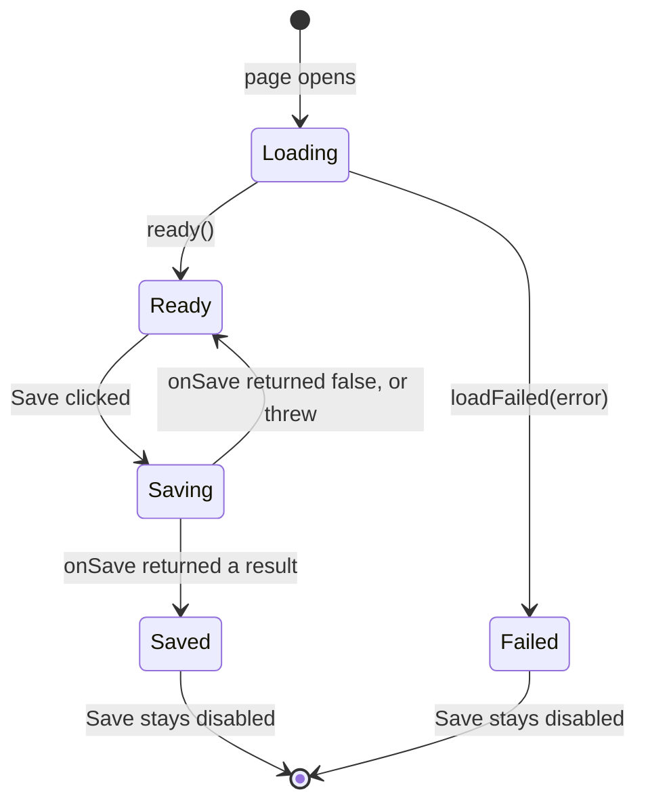

---
sidebarTitle: "UI components"
---

# UI components (`src/ui`)

> **Reference.** The React kit: fields, layout, save bar, feedback. Lists, tables, charts, dialogs and tabs: [next page](ui-components-data.md).
> Import from `"@ui"` (an [alias](../project/configuration.md#import-aliases)). Tests in `test/unit/ui/`.

Function components, hooks and a few plain helpers. A page declares its fields as data, draws
them by name, and gets the same labels, required markers, error messages, accessibility wiring,
loading states and Save behaviour on every page.

```tsx
import { choice, Field, FormContext, Page, SaveBar, text } from "@ui";

// 1. Declare the fields once, as data
const fieldSpecs = {
  subject: text({ id: "subject", label: "Subject", required: true, maxLength: 200 }),
  priority: choice({ id: "priority", label: "Priority", table: "task", column: "prioritycode" }),
};

// 2. Keep the values, errors and options in state; give them to the fields through FormContext
<FormContext.Provider value={{ specs: fieldSpecs, values, errors, options, locked: {}, isVisible: () => true, change }}>
  <Page title="Task">
    <Field name="subject" />
    <Field name="priority" />
    <SaveBar bar={bar} />
  </Page>
</FormContext.Provider>
```

[Build a feature: a worked example](../../4-build/build-a-feature/01-scaffold-and-config.md) shows a whole page, and
`src/features/quick-task/page/QuickTaskPage.tsx` is a complete small one.

## Field specs

A spec says what a field is. Builders in `src/ui/form/specs.ts` add the `kind` and, for the
Dataverse-backed ones, the function that loads the options.

| Builder | Draws | Value held in the form | Typed with |
|---|---|---|---|
| `text({ id, label, maxLength, rows, type, placeholder })` | an input, or a text area with `rows` | `string` | trim it |
| `number({ id, label, min, step })` | a number input | `string` (as typed) | `parseNumber(raw)` → `number \| null` |
| `date({ id, label })` | a date input | `"yyyy-mm-dd"` or `""` | `parseDate(raw)` → `string \| null` |
| `choice({ id, label, table, column, placeholder, extraOptions })` | a select, options from the column's metadata | the option value as text | `parseChoice(raw)` → `number \| null` |
| `yesNo({ ...same })` | a select with Yes and No (and "not answered") | `"true"`, `"false"` or `""` | `parseYesNo(raw)` → `boolean \| null` |
| `lookup({ id, label, table, filter })` | a select of the table's active records, sorted by name | the record id | `parseId(raw)` → `string \| null` |
| `checkboxes({ id, label, table, filter })` | one checkbox per active record, e.g. the records to link through an N:N with `associate` | `string[]` of ids | use the array |

**Common options:** `required`, `hint` (help line under the label), `requiredMessage` (replaces
"Enter \<label>." / "Select \<label>."), `placeholder`, `readOnly`. Selects (`choice`, `yesNo`,
`lookup`) also take `extraOptions`, options added after the loaded ones, e.g.
`[{ value: "na", label: "Not applicable" }]`: they count as answered, and `parseYesNo("na")` reads
as `null`.

**Ids.** A field's `id` must be unique on the page. Four ids are used by the kit itself: `status`,
`save`, `openRecord` and `fillTestData`. The control gets the `id`, its error message `<id>-error`,
its hint `<id>-hint`; a checkbox list is a `<fieldset id="<id>">` and its checkboxes are
`<id>-0`, `<id>-1`... Browser tests use these.

## Drawing fields

| Component | Gives |
|---|---|
| `FormContext` | Provider for the form: `{ specs, values, errors, options, locked, isVisible, change }` (type `FormContextValue`). |
| `useForm()` | The form a component is in; throws outside a `FormContext.Provider`. For a component that draws from the form like `Field`. |
| `<Field name="x" belowLabel={...} />` | Draws the field `x` from the context: the right control for its kind, its value, its error, its options. Draws nothing while `isVisible("x")` is false. Throws, naming the field, for a name that is not in `specs`. `belowLabel` puts extra content under the label (the approver hint). |
| `TextField`, `NumberField`, `DateField`, `SelectField`, `CheckboxListField` | The controls `Field` chooses between. Take a `spec`, the `value`, an `error` and `onChange`; use them directly for a field that is not in a form context. |
| `FieldShell` | The wrapper every field shares: label with the required marker, hint, control, error. Build a new kind of field inside it. |
| `controlA11y(id, hint, error)` | The `aria-describedby` / `aria-invalid` attributes for a control. |

A select whose options are not loaded yet (`options[name]` is `undefined`) is disabled and shows
"Loading...". After an error is set, the control has `aria-invalid` and the error is read as part
of its description; the page clears it when the user changes the field.

A follow-up field that is only sometimes asked is `required: true` and hidden by `isVisible`:
`checkRequired` skips hidden fields, so it is required exactly while it is shown.

## Checking required fields

| Function | Gives |
|---|---|
| `checkRequired(specs, values, isVisible, strings?)` | `{ errors, first }`: a message for every visible required field that is empty, and the name of the first. Does not touch the screen; the page puts `errors` in its state. `strings` (default `uiStrings.en`) gives the language of the messages. |
| `focusField(spec)` | Moves the keyboard focus to the field (the first checkbox of a list). |
| `isEmpty(spec, value)`, `requiredMessage(spec, strings?)` | The pieces `checkRequired` uses. `strings` (default `uiStrings.en`) gives the language of the message. |
| `parseNumber`, `parseChoice`, `parseYesNo`, `parseId`, `parseDate` | Text from a control → the typed value, `null` when empty. |
| `emptyValue(spec)` | `[]` for a checkbox list, `""` for any other field: the starting value. |

Types: `FieldSpec` (any spec, told apart by `kind`: `text`, `number`, `date`, `select`,
`checkboxes`), `FieldValue` (`string` or `string[]`), `Option` (`{ value, label }`).

## Layout

| Component | Gives |
|---|---|
| `<Page title>` | The page container: `<main class="pp-page">` and the `<h1>`. |
| `<Section title>` | A titled group (`<fieldset>` and `<legend>`). |
| `<Row>` | Fields side by side, wrapping to one column in a narrow dialog. A row whose fields are all hidden takes no space. |
| `mountPage(<Page />)` | The page's entry point (`page/index.tsx`): draws the page into `#root` inside `<StrictMode>` when the document has loaded. It wraps the page in `LanguageProvider` and always mounts `StandaloneLookupHost` next to the page. |

## Standalone pages

A navigation page with no parent form uses the standalone client of the [core API](core-api.md) and the components below. Neither is exported from `@ui`: a page imports them by path or uses them
through `mountPage`.

| Component | Gives |
|---|---|
| `RecordPicker` (`src/ui/record-picker/RecordPicker.tsx`) | A modal, searchable picker for one record of a table: results in pages of 25 with "More results", Cancel, and the table's display name in its wording. Props: `lookup` (a `StandaloneLookup`) and `onClose(records)`. Stale responses after a new search are dropped. |
| `StandaloneLookupHost` (`src/ui/record-picker/StandaloneLookupHost.tsx`) | Listens for lookup requests from `openStandaloneLookup` and shows one `RecordPicker` at a time. A new request cancels the open one. `mountPage` mounts it, so every page has it. |

## Languages

The kit is written in English and French. `mountPage` wraps every page in `LanguageProvider`,
which picks the page's language in this order: the choice the user made with the switch (saved in
`localStorage` under `pp-language`, and only when they switch), else the Dynamics user's language
(French when `userSettings.languageId` is 1036), else the browser's. It sets `<html lang>` to
`fr-CA` or `en-CA`.

| Component or function | Gives |
|---|---|
| `LanguageProvider` (`initial?`) | Provides the language to the page. `initial` overrides the starting choice (tests use it); `mountPage` gives none. |
| `useLanguage()` | `{ language, setLanguage }` from the nearest provider. |
| `useUiStrings()` | The kit's text in the current language. |
| `LanguageSwitch` | A button that switches between English and French. It names the other language ("Français" or "English"). |
| `uiStrings` / `UiStrings` | Every kit text, by language: `uiStrings.en` and `uiStrings.fr`. |
| `localize(text, language)` / `Localized` | The text for a `Localized` value: a plain string, or a function of the language. |

The kit's components draw their own words (Loading, Select an option, Save, Cancel, Previous and
Next, the record picker) in the current language. Text a page passes as props (titles, labels,
`saveLabel`) is the page's to translate. A status message can be a function of the language, so it
redraws when the user switches: `useSaveBar`'s `info`, `error` and `SaveResult.message` accept one.

## Feedback and status

| Component | Gives |
|---|---|
| `<Alert kind title>` | A message box. `kind` is `"info"` (default), `"success"`, `"warning"` or `"error"`; `title` is an optional bold lead-in; the message is the children. An error has `role="alert"`, the others `role="status"`. |
| `<Spinner label>` | A turning ring with a text (default "Loading..."). Honours reduced motion. |
| `<Badge tone>` | A pill for a status: `"neutral"` (default), `"accent"`, `"success"`, `"warning"` or `"error"`. Say the status in the text too. |

## Saving

| Function | Gives |
|---|---|
| `useSaveBar(onSave)` | Returns a `SaveBarController`, the state of the bottom bar: `status`, `saveDisabled`, `open`, and the methods `ready()`, `loadFailed(error)`, `save()`, `info(message)`, `error(message)`. `onSave(bar)` gets the bar's `info` and `error`, and returns `false` to stop (validation showed its messages), a `SaveResult` `{ message?, open? }`, or throws (shown as "Saving failed: ..."). `info`, `error` and `SaveResult.message` take text or a function of the language (`Localized`); the default message is the kit's "Saved." in the current language. A click during a save is ignored. After a successful save, Save stays disabled. |
| `<SaveBar bar saveLabel openLabel />` | Status (`#status`), Open the record (`#openRecord`, only after saving) and Save (`#save`, disabled until `ready()`). |
| `<TestDataBox onFill label />` | "Fill with test data" (`#fillTestData`) in a dashed box; renders nothing in production. |
| `<Button id secondary danger disabled onClick ref>` | The button the bar uses. `danger` is the red look; `ref` gives the DOM button, e.g. to move the focus to it. |



*The states of the save bar. The status line says "Saving...", the result's message, or "Saving failed: ...".*

## How a component is built

Every component is a function with a doc comment, in its own folder with its own stylesheet:

```
src/ui/
  tokens.css                   colours and spacing as CSS variables
  index.ts                     what a page imports
  field/                       FieldShell, InputField (shared by NumberField and DateField), TextField,
                               SelectField, CheckboxListField, field.css, checkbox-list.css
  form/                        types.ts (specs), specs.ts (builders), parse.ts, required.ts,
                               FormContext.tsx, Field.tsx
  layout/                      Page, Section, Row (layout.tsx), mountPage and their .css
  save-bar/  test-data/        Button, SaveBar, useSaveBar, TestDataBox and their .css
  record-picker/               RecordPicker, StandaloneLookupHost and record-picker.css
  alert/ badge/ chart/ dialog/ description-list/ item-list/ pagination/ spinner/ table/ tabs/
                               one component each with its .css, plus plain helpers (see the next page)
```

- **Markup** is JSX in the `.tsx` file. There is no string of HTML and no `innerHTML` anywhere.
- **Styles** are in the `.css` file next to the component, with `pp-` class names and the `--pp-*`
  variables. The component imports it (`import "./field.css"`), which is how the build knows to
  ship it. No `style={...}` props.
- **Behaviour** is props, state and hooks. A component does not read Xrm; the page does.

`test/unit/conventions.test.ts` fails when `src/` creates elements by hand, writes HTML in a
string, sets `dangerouslySetInnerHTML` or an inline `style`, or when the core imports React.

## Styles

Each component's `.css` is bundled into the published `page.css` in front of the feature's own
`page/page.css` (the preview does the same), so the page's rules come later and override
anything. Colours are CSS variables (`--pp-accent`, `--pp-error`, `--pp-chart-1`...) in `tokens.css`, matching the
model-driven app's Fluent look; set them in `page.css` to restyle one page.

## Adding a component

A step-by-step guide with two worked examples (a display component and a field) is
[Add a UI component](../../4-build/add-a-ui-component.md). In short:

1. A folder `src/ui/<name>/` with `<Name>.tsx` and, if it needs styles, `<name>.css`.
2. Build a labelled input inside `FieldShell` and `controlA11y`.
3. No project table names (take them as props); a test in `test/unit/ui/`, with Testing Library.
4. Export it from `src/ui/index.ts`, add a showcase panel in `quick-task` and a row to a reference page.
