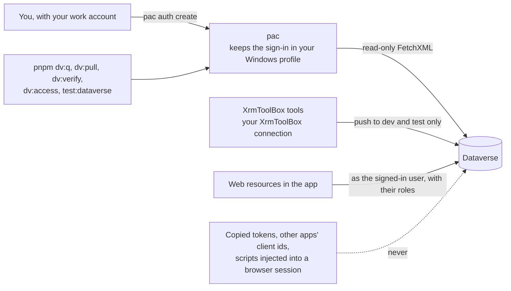

# Access and security

> **For:** everyone. **Result:** you know the only ways the project reaches Dataverse, what never
> to do, and what access a new teammate needs. Signing in step by step:
> [install and sign in](../2-set-up/01-install.md).

## How the tools reach Dataverse

*The only ways in. The repository never sees a password or a token.*

| From | How | Can |
|---|---|---|
| `pnpm dv:*`, `pnpm test:dataverse` | write FetchXML to a temporary file and run `pac org fetch`, signed in as you | **read only**. pac has no row-delete command, and the project does not add one |
| Web Resources Manager, Command Buttons, Flows as Code | your XrmToolBox connection | write to **dev and test only**: each asks once whether an environment is dev or test, and refuses production |
| Web resources in the app | the signed-in user's session | what that user's security roles allow |

Test and prod change only by [solution import](../6-ship/deploy/05-export-import.md), never by hand
or by a tool.

## Runtime services

A project may also run code outside Dataverse, for example an Azure Function that reads an outside
service on a timer. Such a service has its own identity and its own secrets, kept in a vault and never
in the repository. Who may create and rotate them is set per project:
[runtime services](runtime-services.md).

## What not to do

The organization's Conditional Access blocks device-code sign-in ("enter a code") and unapproved
apps. That is a security control, not an obstacle to route around. Never:

- copy or reuse pac's (or any other app's) access token;
- sign in with another app's client id to look like an approved app;
- inject scripts into a signed-in browser session to call the Web API;
- store credentials or tokens in the repo, in `.env` files that get committed, or in flows;
- commit real rows: `pnpm dv:pull --records` copies real data, so replace names, emails and phone
  numbers before you commit.

If a task needs access the tools do not give, ask for it. `pnpm dv:access [email]` shows what is
missing (user, roles, publisher, solution), so you can ask for exactly that.

## The proper fix for team access

So each new teammate does not need individual exceptions, an administrator sets up once:

1. One **Entra ID app registration** for developer tools.
2. A **Conditional Access** rule allowing that app for a **"PI Developers"** security group.
3. A **Dataverse team** linked to that group (group team) with the security roles developers
   need in dev (read in prod).

Adding a person to the group then gives them access everywhere it is needed, and removing them
takes it away.

## Permissions to request for a new teammate

| Where | Access |
|---|---|
| Dev | a role that can customize the solution (System Customizer), and read on the project's tables |
| Test | the same as dev if they deploy there; otherwise read |
| Prod | read, or nothing; changes go through solution import |
| Flow Run table | read, for the Runs tab of Flows as Code |
| SharePoint | the sites the flows read, if they will edit those flows |
| Power Automate | a license that covers the connectors used (premium for Dataverse) |

Check the result with `pnpm dv:access new.teammate@example.com` (looking up someone else needs read
access to users and roles).
