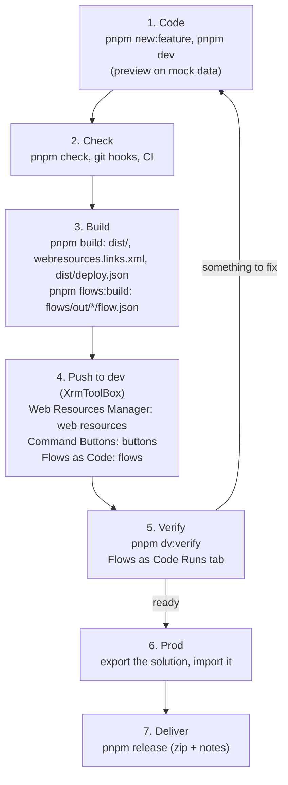

# Start here

> **For:** everyone on the project, on the first day and every day after. **Result:** you know
> what you will build, the loop you will repeat, and which page answers which question.

<Note title="Read these docs on your laptop">
The best way to read and use these docs is locally with `pnpm docs:serve`: there you get instant
navigation, full search and the Ask-the-docs chat. A copy hosted in Dataverse (as web resources)
is a convenient read-only mirror — every page is there, but each link is a full-page reload and the
AI chat is off. For anything more than a quick look, run it locally.
</Note>

## What you build

You add features to a **model-driven app** in Power Apps:

- **Features**: a command bar button that opens a dialog, written in TypeScript and React, built
  into ordinary web resources.
- **Flows**: Power Automate cloud flows, written in Python with `flowkit` and built into flow JSON.

Both are written, previewed and tested on your laptop against mock data, then pushed to the
**dev** environment with three XrmToolBox tools, and moved to **prod** inside a solution.

## The daily loop



*Steps 1 to 5 repeat many times a day. Steps 6 and 7 happen when a piece of work is done.*

Every tool that reads Dataverse goes through pac, signed in as you, and only reads. The
XrmToolBox tools push to dev and test only and refuse production. Never work around a sign-in
or Conditional Access block: see [access and security](9-help/access-and-security.md).

## Where to start

Read the parts in this order the first time:

| Step | Part | What you get |
|---|---|---|
| 1 | [Learn](1-learn/01-power-platform.md) | Power Platform for web developers, how the project works, React in a web resource |
| 2 | [Set up](2-set-up/01-install.md) | the tools on your laptop, pac signed in; then [a new project](2-set-up/02-start-a-new-project.md) if you are the one creating it |
| 3 | [Your first feature](3-first-feature/first-feature.md) | a small feature and flow built alone, checked by `pnpm first-feature:check` |
| 4 | [Build](4-build/build-a-feature.md) | features, real data, UI components, tests |
| 5 | [Flows](5-flows/build-a-flow.md) | flows as code and the patterns they use |
| 6 | [Ship](6-ship/deploy.md) | dev, verify, prod, failed flow runs, releases |
| 7 | [Maintain](7-maintain/update-the-kit.md) | taking the starter's newer kit, publishing the docs |

The [reference](8-reference/index.md) holds exact formats and options; [help](9-help/troubleshooting.md)
is for when you are stuck.

## I want to...

| ... | Read |
|---|---|
| understand Power Platform as a web developer | [Power Platform for web developers](1-learn/01-power-platform.md) |
| understand how this repository is built, and what each tool is for | [How the project works](1-learn/02-how-the-project-works.md) |
| know what React can and cannot do in a web resource | [React in a web resource](1-learn/03-react-in-web-resources.md) |
| set up my laptop and sign in | [Install](2-set-up/01-install.md) |
| find out what is wrong with my setup | [Install: the doctor](2-set-up/01-install.md#something-is-wrong-run-the-doctor) |
| install the XrmToolBox tools | [Install: XrmToolBox](2-set-up/01-install.md#2-install-xrmtoolbox-and-the-teams-tools) |
| start a new project from the starter | [Start a new project](2-set-up/02-start-a-new-project.md) |
| prove I am ready for a real task | [Your first feature](3-first-feature/first-feature.md) |
| add a command button and dialog | [Build a feature](4-build/build-a-feature.md) |
| look at real tables and data | [Read real data](4-build/read-real-data.md) |
| add a form component | [Add a UI component](4-build/add-a-ui-component.md) |
| test what I wrote, and run the checks CI runs | [Test and check](4-build/test-and-check.md) |
| add a Power Automate flow | [Build a flow](5-flows/build-a-flow.md) |
| find the right flow block | [Flow patterns](5-flows/flow-patterns.md) |
| write a flow expression | [Flow expressions](8-reference/flows/flow-expressions.md) |
| deploy for the first time | [Deploy your first solution](6-ship/deploy/01-first-time.md) |
| put my work in dev and prod | [Deploy](6-ship/deploy.md) |
| check that dev has what I built | [Deploy: verify](6-ship/deploy.md#5-verify) |
| find out why someone cannot work in dev | [Deploy: before you start](6-ship/deploy.md#before-you-start) (`pnpm dv:access`) |
| see why a flow run failed | [When a flow fails](6-ship/when-a-flow-fails.md) |
| hand the project over as a checked zip | [Make a release](6-ship/release.md) |
| take the starter's newer tools into my project | [Update the kit](7-maintain/update-the-kit.md) |
| read the docs as a website, or change them | [Write the docs](7-maintain/write-the-docs.md) |
| find a command, option or environment variable | [Commands](8-reference/project/commands.md) |
| know what a config file holds | [Configuration](8-reference/project/configuration.md) |
| know what each XrmToolBox tool reads from the project | [XrmToolBox tools](8-reference/tools/overview.md) |
| use a core function or a form component | [Core API](8-reference/web-resources/core-api.md), [UI components](8-reference/web-resources/ui-components.md), [lists, tables, charts, dialogs and tabs](8-reference/web-resources/ui-components-data.md) |
| know what goes in config.ts, schema.ts, ... | [Feature files](8-reference/web-resources/feature-files.md) |
| change mock data or use the test helpers | [Mock Dataverse](8-reference/web-resources/mock-dataverse.md) |
| use a flowkit helper | [flowkit](8-reference/flows/flowkit.md) |
| check the rules before a review | [Conventions](8-reference/project/conventions.md) |
| understand a word | [Glossary](8-reference/project/glossary.md) |
| fix an error | [Troubleshooting](9-help/troubleshooting.md) |
| know what access I need and what not to do | [Access and security](9-help/access-and-security.md) |

## Keeping the docs right

- A change that adds a command, option, setting or function updates its reference page in the
  same commit.
- A fact goes in one page. Elsewhere, link to it.
- When you had to ask someone something, the answer belongs here.
- Diagrams are [Mermaid](https://mermaid.js.org) in a fenced block (` ```mermaid `), so they are
  text, reviewed in git and drawn by the site. Keep them small, label the arrows, and say in a
  caption what to take from them. The site loads Mermaid from a CDN, so viewing needs internet
  access; the source stays readable without it.
- Code in the docs is the real thing: the worked example is a feature that was built, linted and
  tested before it was pasted here, and the flow patterns are run by `pnpm test:flows`. When you
  change the code, change the page.
- One page covers one subject: split a long guide into sub-pages.
